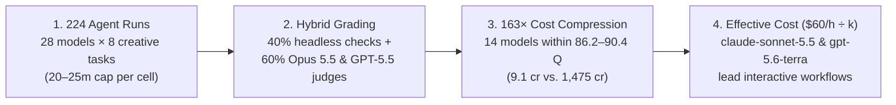
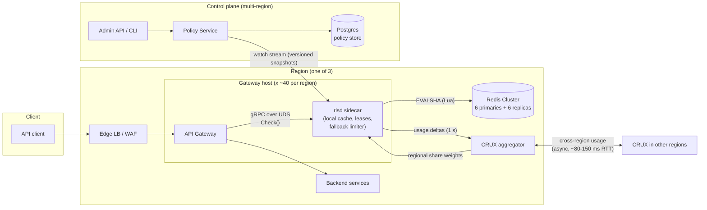

# Benchmarking GitHub Copilot Models on 8 Creative & Multimodal Tasks: Quality Is Compressed, Cost Varies 163×

In [The Real Cost of GitHub Copilot Models](/the-real-cost-of-github-copilot-models/), we benchmarked 28 hosted models on single-turn speed and unit-tested Python coding tasks (`bugfix`, `expr`, `csvstats`, `regex`).

Unit tests tell you whether an agent can satisfy `pytest`. They do not tell you what happens when you ask an agent to build artifacts that **humans actually look at and interact with**: a **real-time 3D lighthouse island in WebGL**, a **16-component SVG system architecture diagram**, a **3,000-word distributed rate-limiter design doc**, a **responsive SaaS landing page**, a **native 16:9 PowerPoint deck**, a **720p30 MP4 explainer video with synthesized audio**, an **HTML5 arcade game**, or an **executive KPI dashboard**.

To test how modern coding agents handle open-ended visual and multimodal engineering, I ran **224 autonomous evaluations (`28 models × 8 creative tasks`)** on **GitHub Copilot CLI (`v1.0.98`)**, consuming **14,549 AI Credits (`~$145.49`)** across **158.9 million tokens** (`10,970` credits for agent generation plus `3,579` credits for dual-model judging). Every deliverable was graded on a `0–100` scale combining **40% automated headless verification** (`83` deterministic checks via Playwright, WebGL, LibreOffice, `python-pptx`, and `ffmpeg`) with **60% dual-LLM visual and qualitative judging** (**`claude-opus-5.5`** + **`gpt-5.5`**).



### Executive Summary: The 5 Core Takeaways

If you only have 60 seconds, here is what the 224 runs prove — and why:

1. **Top-tier creative quality is compressed into a `4.2`-point band, while compute cost varies by `163×`:** The top 14 models all score between **`86.2` and `90.4`** (within single-run noise of `±2–3` points), yet completing all 8 tasks costs **`$0.09` (`9.1 cr`)** on **`auto`** and **`$0.23` (`23.2 cr`)** on **`claude-haiku-5.5`** versus **`$14.75` (`1,475 cr`)** on **`claude-opus-5`**. Most modern models have already mastered the deterministic structural floor (`98%–100%` automated checks); paying `100×` more only buys marginal aesthetic polish.
2. **Visual self-inspection (`view()`) matters far more than internal chain-of-thought (`reasoning` tokens):** Models that wrote code blindly without viewing rendered screenshots (**`gpt-5.3-codex`**, `0` `view` calls, `#24`) failed visually despite clean syntax. Conversely, models that burned `45%–72%` of their output on internal reasoning tokens (**`grok-4.7`**, **`gemini-3.8-flash`**) got trapped in 20-minute over-polishing loops. The winners (**`claude-opus-5.5`**, **`claude-sonnet-5.5`**, **`gpt-6-sol`**, **`gpt-6.1-sol`**) kept reasoning lean (`10%–13%`) and inspected `1–3` rendered screenshots per task.
3. **Single-judge visual benchmarks are systematically skewed (`14.7`-point severity gap + `4.1`-point self-family bias):** Across 223 deliverables, **`claude-opus-5.5` grades `14.69` points harsher than `gpt-5.5`** (`68.8` vs. `83.5`), and each judge favors its own model family by **`~4.1` relative points** — enough to flip #1 between `claude-opus-5.5` and `gpt-6.1-sol`. Pairing cross-vendor judges cancels both biases out.
4. **Your workflow concurrency (`k`) determines which model is actually cheapest:** When an engineer (`$60/hour`) waits interactively on **`k = 1–3` tasks**, human waiting time makes up `79%–99.6%` of total cost, making fast models — **`gpt-5.6-terra` (`12.9 min`, `$14.37` total at `k = 1`)** and **`claude-sonnet-5.5` (`17.1 min`, `$18.73` total, `Q = 88.8`)** — cheaper overall than `$0.09` **`auto`** (`23.2 min`, `$23.28` total). Only at **`k ≥ 4` parallel tasks** (`k* = 4.00`) does `auto` beat `claude-sonnet-5.5`.
5. **Orphaned background servers (`+600s` hang) and software WebGL (`2.6 FPS`) silently distort agent benchmarks:** Session logs reveal that 5 cells finished their work in 1.5–9 minutes but sat idle for **exactly 600 seconds (10 minutes)** waiting on an unstopped `python3 -m http.server` child process (`COPILOT_TASK_WAIT_TIMEOUT_SECONDS`). Removing that single harness artifact cuts **`gpt-5.6-luna`'s** 8-task runtime from `24.1m` to **`14.1m` (#2 fastest overall)**.

| If Your Goal Is... | Pick This Model | The Evidence (`8-Task Suite`) |
| :--- | :--- | :--- |
| **Best all-around interactive model (`k = 1–3` tasks)** | **`claude-sonnet-5.5`** *(or **`gpt-5.6-terra`** for max speed)* | **`Q = 88.8`**, **100% auto checks**, finishes all 8 tasks in **`17.1 min`** for **`$1.61` credits** (`$18.73` total cost at `$60/h`, beating every `Q ≥ 88` model). `gpt-5.6-terra` (`Q = 86.2`) finishes in **`12.9 min`** (`$14.37` total). |
| **Maximum flagship quality & reliability** | **`claude-opus-5.5`** or **`gpt-6-sol`** | **`claude-opus-5.5`** is **#1 overall (`Q = 90.4`, `84.6` judge)** at **64% lower credit cost** and **58% less time** than `claude-opus-5`. **`gpt-6-sol`** is **#3 (`Q = 89.8`, 100% auto checks)** in just **`22.2 min` (`$2.09`)**. |
| **3D WebGL scenes, SVG diagrams & MP4 videos** | **`gemini-4-argon`** *(background)* or **`gpt-6.1-sol`** *(fast)* | **`gemini-4-argon` (`Q = 89.3`)** ranks **#1 on `three_d` (`89.8`), #1 on `diagram` (`92.5`), and #1 on `video` (`93.3`)**, though it takes `72.7 min`. **`gpt-6.1-sol` (`Q = 89.4`)** scores `89.2` on `three_d` for just **`$1.41` total credits**. |
| **High-volume batch runs (`k ≥ 4`) or strict credit budgets** | **`auto`** *(→`gpt-6-luna`)* or **`claude-haiku-5.5`** | **`auto` (`Q = 87.4`)** completes all 8 deliverables for **`$0.09` (`9.1 credits`)**. **`claude-haiku-5.5` (`Q = 87.1`, `$0.23`)** won **#1 overall on `dataviz` (`92.5`)** and **#2 on `ui_landing` (`90.4`)**. |

---

## 1. The 163× Cost Compression Frontier: Why 14 Models Cluster Within 4.2 Points

> **Core Conclusion:** Unlike algorithmic coding — where models either pass 100% of strict unit tests or fail outright — creative multimodal engineering exhibits **steep quality compression at the top (`86.2` to `90.4`) alongside a `163×` explosion in credit cost (`9.1 cr` to `1,475.0 cr`)**. Once a model clears the deterministic structural checks, spending 10× to 100× more compute yields diminishing aesthetic returns that are smaller than single-run variance (`±2–3` points).

Why does the quality distribution flatten out so dramatically on creative tasks? Because every multimodal engineering task has two distinct layers: a **deterministic structural floor** (`40%` of our score: valid DOM/XML, exact CSV numbers, working `ffmpeg` streams, responsive viewports) and an **open-ended aesthetic ceiling** (`60%` of our score: visual composition, color harmony, animation polish, and architectural prose).

Our data shows that **almost every modern frontier model has already solved the structural floor**: 24 of the 28 models pass **98% to 100%** of the 83 automated headless checks across all 8 tasks. Where models diverge is how much compute and time they burn chasing the last few points of visual polish:

- **Quality is tightly compressed across the top half of the leaderboard:** **14 of the 28 models score between `86.2` and `90.4`** — a `4.2`-point spread across 8 radically different media formats.
- **Compute cost across those same 14 models spans `163×`:** Generating all 8 deliverables costs **`9.1 credits` (`$0.09`)** on **`auto`** and **`23.2 credits` (`$0.23`)** on **`claude-haiku-5.5`**, compared to **`1,006.4 credits` (`$10.06`)** on **`gpt-6-astra`**, **`1,211.5 credits` (`$12.12`)** on **`claude-fable-5`**, and **`1,475.0 credits` (`$14.75`)** on **`claude-opus-5`**.
- **Wall-clock time spans `14.8×` overall (`6.6×` within the top 14):** **`gpt-5.6-terra`** finishes all 8 tasks in **`12.9 minutes` (`776s`, `Q = 86.2`)** and **`claude-sonnet-5.5`** finishes in **`17.1 minutes` (`1,027s`, `Q = 88.8`)**, whereas **`claude-opus-5`** takes **`85.6 minutes` (`5,138s`, `Q = 89.3`)** and **`grok-4.7`** takes **`143.7 minutes` (`8,621s`, `Q = 76.8`)**.


Tracing the two Pareto frontiers in **Fig. 1** (Quality vs. Credits on the left; Quality vs. Wall-Clock Time on the right) isolates five standout models on the efficiency boundary:

1. **`claude-opus-5.5` (`Q = 90.4`, `525.8 cr / $5.26`, `36.3 min`) — The Flagship Quality Leader:** Ranks #1 overall with a `99.1%` automated check score, `84.6` mean judge score, and zero timeouts. More importantly, it cuts credit spend by **64%** and wall-clock time by **58%** compared to its predecessor `claude-opus-5` (`Q = 89.3`, `1,475.0 cr / $14.75`, `85.6 min`).
2. **`gpt-6-sol` (`Q = 89.8`, `208.9 cr / $2.09`, `22.2 min`) & `gpt-5.6-sol` (`Q = 89.6`, `369.2 cr / $3.69`, `22.8 min`) — The Zero-Defect All-Rounders:** Rank #3 and #4 overall, and are two of only six models in the benchmark to achieve a **perfect `100.0%` automated check score** across all 8 tasks while finishing in just over 22 minutes.
3. **`gpt-6.1-sol` (`Q = 89.4`, `140.6 cr / $1.41`, `27.5 min`) — The `Q ≥ 89` Cost Pareto Winner:** Ranks #5 overall and is the **cheapest model in the `Q ≥ 89` tier**, reading only `2.03M` input tokens across `68` disciplined tool calls.
4. **`claude-sonnet-5.5` (`Q = 88.8`, `161.2 cr / $1.61`, `17.1 min`) — The Interactive Speed & Reliability Sweet Spot:** Ranks #8 overall, achieves a **perfect `100.0%` automated check score**, and is the **fastest model in the `Q ≥ 88` tier** (`1,026.9s` total, averaging just `2.1 minutes` per deliverable).
5. **`auto` (`Q = 87.4`, `9.1 cr / $0.09`, `23.2 min`) — The `$0.01`-per-Task Bargain (and a Natural Noise Experiment):** Ranks #11 overall at **~$0.01 per deliverable**. Inspecting the raw session telemetry (`result.json`) reveals why `auto` was so cheap: **in this run, `auto` routed 100% of its 92 API turns across all 8 tasks to `gpt-6-luna`**. Because standalone `gpt-6-luna` scored `84.7` (`10.2 cr / $0.10`) on the exact same suite, this pair gives us a direct empirical measurement of single-run stochastic variance (`+2.7` quality points from slightly deeper tool verification: `96` tool calls vs. `89`).

---

## 2. Inside the 8 Creative Tasks: Why Spatial Geometry Breaks Models While Procedural Pipelines Succeed

> **Core Conclusion:** Ranking the 8 tasks from hardest (`three_d`, median `83.2`) to easiest (`video`, median `89.5`, `28/28` automated pass) reveals a clear law of multimodal agents: **tasks that rely on procedural data pipelines (`video`, `dataviz`) or standard DOM flows (`ui_landing`) are largely solved, whereas tasks requiring explicit 2D/3D coordinate geometry (`three_d`, `diagram`, `presentation`) trigger the vast majority of structural failures and timeouts.**

Why did all 28 models (`100%`) pass every automated check on `video` (`1280×720` H.264 MP4 with synthesized AAC audio) and compute the exact `$19,310,198` revenue on `dataviz`, while 9 models failed automated checks on `three_d` and 7 failed on `presentation`?

The reason comes down to **how much raw spatial geometry the model must hold in its head while writing code**. When generating a Bubble Sort explainer video (`video`) or a sales dashboard (`dataviz`), an agent writes a procedural loop in Python (`Pillow`/`matplotlib` → `ffmpeg`) or binds CSV aggregates to DOM elements; the rendering engine handles frame timing and layout math automatically. By contrast, when building a 3D Three.js scene (`three_d`), a 16-node SVG architecture diagram (`diagram`), or an OOXML PowerPoint deck (`presentation`), the agent must manually compute 3D camera frustums, viewport resize buffers, 2D text bounding boxes, or integer EMU coordinates. Without rendering a screenshot and inspecting it visually, a single miscalculated coordinate clips text off the canvas or leaves a WebGL scene frozen.

Each cell ran in an isolated working directory with a **20-minute wall-clock limit** (**25 minutes** for `presentation` and `video`) and zero internet access allowed inside the rendered deliverables (`no_external_requests` / `no_installed_dependencies`).

| Task (`case`) | Deliverable & Verification Stack | Key Automated Gate Checks (`40%` Weight) | Auto `100%` | Median `Q` | Top 3 Models (`Quality`) | Cheapest `Q ≥ 85` | Fastest `Q ≥ 85` |
| :--- | :--- | :--- | :---: | :---: | :--- | :--- | :--- |
| **1. `three_d`** *(Hardest)* | `scene.html` · Playwright WebGL (`1280×720`, 2 frames 3s apart + `800×800` resize) | Local `vendor/three/` importmap, `window.sceneReady`, WebGL canvas fills viewport, non-blank render, frame diff animation, resize handler, 0 JS/network errors | `19/28` | **83.2** | `gemini-4-argon` (`89.8`), `gpt-6-astra` (`89.2`), `gpt-6-sol` (`89.2`) | `gpt-6.1-sol` (`18.9 cr`, `89.2`) | `gpt-5.6-sol` (`105.7s`, `88.6`) |
| **2. `diagram`** | `architecture.svg` · XML parser + Chromium raster (`1600px` wide) | Valid XML + `viewBox`, vector-only, all 16 ShopFast labels, 5 zone labels (`Clients`, `Edge`, `Services`, `Data`, `External`), dashed async `OrderPlaced` Kafka arrows, legend, **0 text overlaps**, **0 clipped labels** | `25/28` | **85.0** | `gemini-4-argon` (`92.5`), `claude-opus-5` (`91.7`), `gpt-6-astra` (`91.7`) | `auto` (`1.2 cr`, `85.0`) | `gpt-6-sol` (`110.1s`, `89.5`) |
| **3. `presentation`** | `deck.pptx` · `python-pptx` AST + headless LibreOffice PDF/JPG render | 8–10 slides at `16:9`, native chart, native table, shape diagram with connectors, speaker notes on every slide, `≤80` words/slide, valid integer OOXML geometry, custom theme | `21/28` | **85.6** | `grok-4.7` (`92.5`), `gpt-6-astra` (`91.7`), `claude-fable-5` (`89.5`) | `auto` (`1.4 cr`, `88.0`) | `claude-sonnet-5.5` (`76.3s`, `86.5`) |
| **4. `design_doc`** | `DESIGN.md` · Markdown AST + regex/topic verifier | `1,500–4,000` words, all 14 required sections in exact order, valid `mermaid` block, Markdown table, quantitative latency/capacity math (`50k RPS`, `≤2ms p99`), concrete API spec, token-bucket + sliding-window + fail-open/closed | `19/28` | **86.5** | `claude-opus-5.5` (`92.2`), `gpt-6-sol` (`92.2`), `gpt-5.6-terra` (`91.6`) | `gpt-6-luna` (`0.7 cr`, `85.3`) | `gpt-5.6-terra` (`67.6s`, `91.6`) |
| **5. `dataviz`** | `dashboard.html` · Playwright (`1440×900`) against 24-month `sales.csv` | Exact 2025 revenue (`$19,310,198`), YoY growth (`30.5%`), top region (`North America`) on `data-testid` hooks, `≥3` inline SVG/Canvas charts, no horizontal scroll at `1440px` | `20/28` | **86.6** | `claude-haiku-5.5` (`92.5`), `gemini-4-argon` (`91.7`), `claude-opus-5` (`91.0`) | `auto` (`0.8 cr`, `85.2`) | `claude-sonnet-5.5` (`65.2s`, `88.7`) |
| **6. `ui_landing`** | `index.html` · Playwright desktop (`1440px`) & mobile (`390px`) interactive test | Semantic layout (`nav`, `footer`, `h1`, `≥6` features), clicking `billing-toggle` updates `price-pro`, `theme-toggle` flips background color, `calc-amount`/`calc-years` updates `calc-result`, 0 mobile scroll | `27/28` | **87.7** | `claude-opus-5.5` (`91.0`), `claude-haiku-5.5` (`90.4`), `claude-opus-5` (`90.4`) | `auto` (`1.4 cr`, `88.0`) | `gpt-5.6-terra` (`107.9s`, `87.4`) |
| **7. `game`** | `game.html` · Playwright 10-second automated gameplay harness | Canvas + live `window.gameState` (`score`, `lives`, `paddleX`, `status`), `Space` starts game, arrow keys move paddle, `P` pauses (static frame) & resumes, score/lives change over 10s play | `25/28` | **87.7** | `claude-opus-5.5` (`92.5`), `claude-opus-5` (`91.7`), `gpt-5.6-sol` (`91.7`) | `auto` (`1.0 cr`, `90.3`) | `gpt-5.6-luna` (`59.1s`, `85.0`) |
| **8. `video`** *(Easiest)* | `video.mp4` · `ffprobe` + `ffmpeg` `volumedetect` & 12-frame diff | `11–13s` duration, `1280×720` @ `30 fps`, `h264` (`yuv420p`), `aac` audio track, non-silent audio, `12/12` non-blank frames, temporal frame progression demonstrating Bubble Sort | **`28/28`** | **89.5** | `gemini-4-argon` (`93.3`), `grok-4.7` (`93.3`), `gemini-3.8-flash` (`92.5`) | `auto` (`0.8 cr`, `88.7`) | `claude-sonnet-5.5` (`57.9s`, `90.3`) |

The complete 224-cell matrix in **Fig. 2** maps every model's quality score, credit spend, wall-clock duration, and automated check status across all 8 tasks:


Below is a task-by-task forensic breakdown — ordered from hardest (`three_d`) to easiest (`video`) — showing what was tested, why the top models won, why the bottom models failed, and what their actual rendered outputs look like.

### 2.1 `three_d` — Real-Time 3D Lighthouse Island (`scene.html`, Three.js / WebGL)

**The Engineering Challenge & Verification (`10` auto checks + `5` judge rubrics):** Agents had to build a self-contained `scene.html` rendering a real-time 3D lighthouse on a rocky island surrounded by animated ocean waves at dusk, mapping `three` to local `./vendor/three/three.module.js` via an ES module `importmap` (`OrbitControls.js` available), modeling the lighthouse from geometric primitives (striped tower, gallery with railing, lantern room, roof, rocks), animating a rotating light beam and waves with dusk lighting/fog, auto-orbiting the camera, handling window resizes, and setting `window.sceneReady = true`. Playwright rendered the scene in headless Chromium WebGL (`--use-angle=swiftshader`) at `1280×720`, captured two frames `3s` apart to verify live animation (`animates`), resized the viewport to `800×800` (`handles_resize`), and handed the screenshots to the judges (`visual_appeal`, `modeling_fidelity`, `lighting_and_mood`, `animation`, `code_quality`).

**Why the Winners Won (`Median Q = 83.2`, `19/28` passed `100%` auto checks):** **`gemini-4-argon` (`89.8`, `96.3 cr`, `1,154.9s`)** took #1 overall because it went beyond basic cylinders: it modeled a tapered red-and-white lighthouse with architectural corbels, a detailed gallery railing, an internal Fresnel lens, a keeper's cottage with warm glowing windows, pine trees, a wooden pier, a rowboat, and jagged sea stacks under a dusk sun. Right behind it, **`gpt-6-astra` (`89.2`, `202.4 cr`, `565.7s`)**, **`gpt-6-sol` (`89.2`, `43.2 cr`, `391.6s`)**, and **`gpt-6.1-sol` (`89.2`, `18.9 cr`, `222.1s`)** tied for #2 — with `gpt-6.1-sol` delivering near-identical visual quality at **1/5th the credits and 1/5th the time** of `gemini-4-argon`. **`gpt-5.6-sol` (`88.6`, `35.5 cr`, `105.7s`)** was the fastest `Q ≥ 85` finisher.

**Why the Bottom Failed:** Eight models (including `claude-opus-5.5` at `86.2`, `claude-opus-5` at `83.2`, and `claude-haiku-5.5` at `80.8`) lost `7.4` automated points (`Auto = 92.6%`) on `handles_resize([1280, 720])` because CSS stretched the canvas without updating the Three.js renderer buffer on `800×800` resize. Three models (`gemini-3.7-flash`, `gemini-3.8-flash`, `grok-4.7`) hit the `1,200s` timeout. Last-place **`gpt-5-mini` (`59.3`)** pointed its spotlight straight up into the sky as a thin vertical line with the bulb floating detached above the roof, and failed both `animates` (`mean pixel diff = 0.53`) and `handles_resize`.


### 2.2 `diagram` — ShopFast System Architecture Diagram (`architecture.svg`)

**The Engineering Challenge & Verification (`12` auto checks + `4` judge rubrics):** Agents had to author a standalone, vector-only `architecture.svg` (`viewBox`, readable at `1600px` wide) for the "ShopFast" e-commerce platform containing **16 exact component labels** (`Web App`, `Mobile App`, `CDN`, `API Gateway`, `Auth Service`, `Catalog Service`, `Cart Service`, `Order Service`, `Payment Service`, `Notification Service`, `Search Service`, `PostgreSQL`, `Redis`, `Kafka`, `S3`, `Stripe`) organized into **5 labelled zones** (`Clients`, `Edge`, `Services`, `Data`, `External`), with solid arrows for synchronous calls, dashed arrows for asynchronous `OrderPlaced` Kafka events, and a legend. Our automated checker parsed the XML and used headless Chromium bounding-box geometry to enforce **`no_text_overlap`** and **`no_text_clipped`** across every `<text>` node.

**Why the Winners Won (`Median Q = 85.0`, `25/28` passed `100%` auto checks):** **`gemini-4-argon` (`92.5`, `35.9 cr`, `308.6s`)** took #1 by laying out five distinct color-coded swimlane columns with orthogonal routed connectors, pill badges for edge labels, and zero text collisions. **`claude-opus-5` (`91.7`, `296.5 cr`, `928.1s`)** and **`gpt-6-astra` (`91.7`, `72.2 cr`, `157.1s`)** tied for #2, followed by **`claude-opus-5.5` (`91.0`, `41.9 cr`, `143.0s`)** and **`grok-4.6` (`90.3`, `41.1 cr`, `448.9s`)**. **`gpt-6-sol` (`89.5`, `19.6 cr`, `110.1s`)** was the fastest `Q ≥ 85` finisher, and **`auto` (`85.0`, `1.2 cr`, `307.7s`)** was the cheapest.

**Why the Bottom Failed:** **`grok-4.7` (`0.0`)** timed out at `1,200s` on both attempts after upstream server errors without writing `architecture.svg`. **`claude-haiku-4.5` (`65.1`, `Auto = 97.0%`)** omitted the required `OrderPlaced` label, hallucinated a direct `API Gateway → Payment Service` arrow, and sized its node boxes too narrow (`60px`) for its text strings, clipping `'Payment Service'` into `'ayment Servic'` and `'Notification Service'` into `'Notification Ser'`. **`gpt-5-mini` (`67.4`)** failed `no_text_overlap` by drawing its `product data` edge label directly across the `Catalog Service` box.


### 2.3 `presentation` — 16:9 Executive PowerPoint Deck (`deck.pptx`)

**The Engineering Challenge & Verification (`11` auto checks + `4` judge rubrics):** Agents had to programmatically generate an 8–10 slide `16:9` PowerPoint presentation (`deck.pptx`) titled *"The Future of Urban Mobility (2030)"* for a city council audience, including a title slide, agenda, closing recommendations, at least one **native PowerPoint chart object** (`python-pptx` chart API, not a PNG), at least one **native shape diagram with connectors**, at least one **native table**, a custom visual theme, `≤80` words of on-slide text per slide, and **speaker notes on every slide**. We verified the OOXML structure via `python-pptx` (including `valid_ooxml_geometry` to catch malformed float coordinates) and rendered every slide via headless LibreOffice + `pdftoppm` for the visual judges.

**Why the Winners Won (`Median Q = 85.6`, `21/28` passed `100%` auto checks):** **`grok-4.7` (`92.5`, `242.8 cr`, `1,215.1s`)** won #1 with a cohesive navy-and-gold 9-slide executive deck where modal shares summed to `100%` and financial/injury targets stayed internally consistent across tables, native charts, and council speaker notes. **`gpt-6-astra` (`91.7`, `144.3 cr`, `277.5s`)** took #2, followed by a 3-way tie at **`89.5`** between **`claude-fable-5`** (`113.9 cr`, `149.3s`), **`claude-opus-5.5`** (`55.1 cr`, `186.3s`), and **`gpt-6.1-sol`** (`21.0 cr`, `247.8s`). **`claude-sonnet-5.5` (`86.5`, `15.3 cr`, `76.3s`)** was the fastest `Q ≥ 85` finisher, and **`auto` (`88.0`, `1.4 cr`, `191.8s`)** was the cheapest.

**Why the Bottom Failed:** Five models (`claude-opus-5`, `claude-sonnet-5`, `gemini-4-argon`, `gpt-5.3-codex`, `grok-4.6`) passed floating-point strings (`'0.0'`, `'1929384.0'`) instead of integers into OOXML connector `cx`/`cy` attributes (`Auto = 92.3%`). Two models (`gpt-5.4-mini` at `117` words/slide and `grok-4.5` at `112` words/slide) violated the `≤80` word limit. Last-place **`gpt-5-mini` (`71.5`)** clipped its main title off the left edge of slide 1 and stamped a decorative orange circle in the exact same spot on every slide, colliding with chart titles and tables.


### 2.4 `design_doc` — Distributed Rate Limiter Technical Design (`DESIGN.md`)

**The Engineering Challenge & Verification (`9` auto checks + `5` judge rubrics):** Agents had to write a `1,500–4,000` word senior-engineering design document (`DESIGN.md`) for a Distributed Rate Limiter handling **`50,000 RPS` at peak across 3 regions** with **`≤2 ms` p99 added latency**, covering per-API-key and per-IP limits, token-bucket and sliding-window algorithms, dynamic configuration without redeployment, graceful Redis degradation, and multi-region consistency. The automated gate enforced **14 exact Markdown section headings in order** (`Overview` through `Open Questions`), at least one valid `mermaid` diagram, a Markdown comparison table, quantitative capacity/latency math, concrete gRPC/HTTP API schemas, and explicit coverage of `token bucket`, `sliding window`, `p99`, and `fail open / fail closed`.

**Why the Winners Won (`Median Q = 86.5`, `19/28` passed `100%` auto checks):** **`claude-opus-5.5` (`92.2`, `60.5 cr`, `211.5s`, `3,294` words)** and **`gpt-6-sol` (`92.2`, `15.6 cr`, `113.4s`)** tied for #1 by designing local-sidecar (`rlsd`) + Redis/Lua token-lease architectures where the hot path stays under `2 ms` p99 via Unix domain sockets and local batch leases, while cross-region reconciliation happens asynchronously (`80–150 ms` RTT). **`gpt-5.6-terra` (`91.6`, `9.9 cr`, `67.6s`)** and **`grok-4.7` (`91.6`, `53.7 cr`, `423.3s`)** tied for #3, and **`auto` (`91.0`, `0.9 cr`, `105.1s`)** took #5 for less than 1 cent.

**Why the Bottom Failed:** Six models (`claude-haiku-4.5`, `claude-haiku-5.5`, `gemini-4-argon`, `gpt-5.4`, `gpt-5.4-mini`, `gpt-6-astra`) wrote solid technical designs (`Auto = 91.7%`) but lost `8.3` automated points for discussing fallback policies without using the exact `fail open` / `fail closed` terminology. Two models (`gpt-5.6-luna`, `gpt-6-luna`) fell short on quantitative math density, and **`gpt-5-mini` (`64.5`, `Auto = 66.7%`)** ignored the required Markdown `#`/`##` headings entirely and proposed a synchronous `50 ms` cross-region borrow timeout that violated the `≤2 ms` p99 requirement by `25×`.

Below is the actual Mermaid architecture diagram generated inside `#1 claude-opus-5.5`'s `DESIGN.md` (`Q = 92.2`):



### 2.5 `dataviz` — Executive KPI Dashboard from 24-Month CSV (`dashboard.html`)

**The Engineering Challenge & Verification (`10` auto checks + `4` judge rubrics):** Given `sales.csv` (`24` months covering `2024–2025` across `4` regions and `4` products), agents had to build a self-contained single-screen `1440×900` executive dashboard (`dashboard.html`) using inline SVG or Canvas (zero external chart libraries, zero runtime `fetch()`). Playwright verified that three exact ground-truth KPI hooks matched `sales.csv` (**`data-testid="kpi-revenue"` = `$19,310,198`**, **`kpi-growth` = `30.5%`**, **`kpi-top-region` = `North America`**), checked for `≥3` chart elements (24-month trend, 2025 region bar, 2025 product donut/pie), and enforced zero horizontal scroll at `1440px`.

**Why the Winners Won (`Median Q = 86.6`, `20/28` passed `100%` auto checks):** Lightweight **`claude-haiku-5.5` (`92.5`, `2.1 cr / $0.02`, `131.5s`)** beat every flagship model in the benchmark! It built a dark-mode executive dashboard with 4 custom SVG charts and sharp analytical callouts (identifying the narrow `$88K` gap between North America and Europe and Asia Pacific's `+57.7%` YoY acceleration). **`gemini-4-argon` (`91.7`, `66.5 cr`, `675.9s`)** and **`claude-opus-5` (`91.0`, `130.0 cr`, `400.0s`)** took #2 and #3, while **`claude-sonnet-5.5` (`88.7`, `15.9 cr`, `65.2s`)** was the fastest `Q ≥ 85` finisher.

**Why the Bottom Failed:** Every single model (`28/28`) computed the 3 CSV KPI numbers accurately (`100%`), proving that deterministic data aggregation is trivial for tool-using agents. However, 8 models lost `6.9` automated points (`Auto = 93.1%`) by using HTML `<div>` progress bars instead of `<svg>`/`<canvas>` elements for their regional/product charts. Last-place **`claude-haiku-4.5` (`72.3`)** suffered a CSS grid bug that left a giant blank hole in the top row, pushed the KPI cards to the bottom of the screen, clipped the line chart after `2025-07`, and plotted monthly points that summed to `$13.7M` instead of `$19.3M`.


### 2.6 `ui_landing` — "Aurora" AI Finance Marketing Landing Page (`index.html`)

**The Engineering Challenge & Verification (`9` auto checks + `5` judge rubrics):** Agents had to build a self-contained, responsive (`1440px` desktop and `390px` mobile with zero horizontal overflow) marketing landing page (`index.html`) for "Aurora", an AI personal finance app, complete with sticky navbar, hero product mockup, `≥6`-card feature grid, interactive compound-savings calculator (`calc-amount` + `calc-years` → `calc-result`), 3-tier pricing table with Monthly/Yearly `billing-toggle` updating `price-pro`, light/dark `theme-toggle` flipping body background color, testimonials, and FAQ accordion. Playwright interactively clicked every toggle, typed into the calculator inputs, and tested mobile responsiveness.

**Why the Winners Won (`Median Q = 87.7`, `27/28` passed `100%` auto checks):** **`claude-opus-5.5` (`91.0`, `163.4 cr`, `560.5s`)** won #1 with a polished aurora-gradient aesthetic, an interactive bar-chart savings visualizer, complete light/dark CSS token parity, skip links, ARIA attributes, and `prefers-reduced-motion` support. **`claude-haiku-5.5` (`90.4`, `2.7 cr / $0.03`, `322.0s`)**, **`claude-opus-5` (`90.4`, `189.1 cr`, `487.2s`)**, and **`gpt-6-sol` (`90.4`, `36.0 cr`, `170.1s`)** tied for #2 — showing that `$0.03` `claude-haiku-5.5` matches `$1.89` `claude-opus-5` on frontend UI generation. **`gpt-5.6-terra` (`87.4`, `21.1 cr`, `107.9s`)** was the fastest `Q ≥ 85` finisher, and **`auto` (`88.0`, `1.4 cr`, `136.0s`)** was the cheapest.

**Why the Bottom Failed:** **`gpt-5-mini` (`59.3`, `Auto = 85.2%`)** was the only model out of 28 to fail automated checks on `ui_landing`: it attached `data-testid="billing-toggle"` to the static "Monthly" button instead of the toggle switch (so clicking it left `price-pro` unchanged at `'$9' -> '$9'`), overflowed horizontally at `390px` mobile, and rendered dark-on-dark unreadable text inside its hero phone mockup in light mode.


### 2.7 `game` — HTML5 Canvas Breakout Arcade Game (`game.html`)

**The Engineering Challenge & Verification (`14` auto checks + `4` judge rubrics):** Agents had to code a playable HTML5 Canvas Breakout game (`game.html`) with Left/Right arrow and mouse paddle controls, position-dependent paddle bounce physics, `≥5` rows of colored bricks, score/lives HUD, `≥2` levels, particle shatter effects, synthesized **Web Audio API** sound effects, start/pause (`P`)/win/game-over screens, and a live `window.gameState` object (`{score, lives, paddleX, status}`). Playwright ran a 10-second automated gameplay harness: pressing `Space` to start, testing arrow keys, pressing `P` to verify the canvas freezes while paused, resuming, and confirming live ball physics and score/lives changes.

**Why the Winners Won (`Median Q = 87.7`, `25/28` passed `100%` auto checks):** **`claude-opus-5.5` (`92.5`, `60.5 cr`, `237.3s`)** took #1 with neon gradient bricks, glowing ball trails, shatter particles, screen shake, floating score popups, sub-stepped collision physics, and 3 multi-hit levels. **`claude-opus-5` (`91.7`, `125.9 cr`, `1,200s` timeout)**, **`gpt-5.6-sol` (`91.7`, `57.7 cr`, `311.9s`)**, and **`grok-4.7` (`91.7`, `120.9 cr`, `1,116.2s`)** tied for #2, while **`auto` (`90.3`, `1.0 cr`, `212.1s`)** and **`claude-sonnet-5.5` (`90.3`, `15.3 cr`, `70.7s`)** delivered arcade-grade games in 1–3 minutes. **`gpt-5.6-luna` (`85.0`, `1.1 cr`, `59.1s`)** was the fastest `Q ≥ 85` finisher.

**Why the Bottom Failed:** **`gpt-5-mini` (`40.2`, `Auto = 31.2%`)** wrote a JavaScript syntax error (`SyntaxError: Unexpected token 'else'`) and never opened the page in a browser to check, resulting in a blank dark box with `window.gameState = None`. **`grok-4.5` (`81.5`, `Auto = 87.5%`)** failed `arrow_keys_move_paddle` (`paddleX` stayed frozen at `350`), and **`claude-haiku-4.5` (`71.2`, `Auto = 93.8%`)** failed `animates_while_playing`.


### 2.8 `video` — 12-Second 720p30 Animated Explainer Video (`video.mp4`)

**The Engineering Challenge & Verification (`8` auto checks + `4` judge rubrics):** Agents had to programmatically synthesize a **`12-second (±1s)`**, **`1280×720`**, **`30 fps`**, **H.264 (`yuv420p`)** MP4 video (`video.mp4`) with a **non-silent AAC audio track** (comparison/swap blips or ambient harmonic tones) demonstrating **Bubble Sort** on 8 bars of different heights, including a title card, smooth bar swap animations with active-pair color highlights, an on-screen step/swap counter, and a sorted end card. `ffprobe` and `ffmpeg` (`volumedetect` + 12-frame contact sheet extraction) verified every stream parameter and frame progression.

**Why the Winners Won (`Median Q = 89.5`, `28/28` passed `100%` auto checks):** Because generating frames in Python (`Pillow`/`numpy`) and piping to `ffmpeg` is a clean procedural task, **all 28 models (`100%`) passed every automated check**. **`gemini-4-argon` (`93.3`, `30.9 cr`, `272.4s`)** and **`grok-4.7` (`93.3`, `156.4 cr`, `1,286.8s`)** tied for #1 by implementing smooth ease-in-out horizontal interpolation during bar swaps, color-coded state badges (`Comparing`, `Swapping`, `Sorted`), and exact step counters (`7 passes, 28 comparisons, 17 swaps`). **`claude-sonnet-5.5` (`90.3`, `10.3 cr`, `57.9s`)** and **`gpt-5.6-terra` (`91.7`, `11.3 cr`, `58.4s`)** synthesized complete 720p30 video + audio explainers in **under 60 seconds**.

**Why the Bottom Lagged:** Even the lowest scorers passed all technical checks, but **`claude-haiku-4.5` (`82.0`)** and **`gpt-6-luna` (`82.7`)** teleported bars instantaneously between array indices without rendering intermediate motion frames, losing judge points on `animation_smoothness` and `explanatory_clarity`.


### 2.9 Summary: The 5 Root Causes Behind All 40 Partial Automated Failures

Across all 224 cells, **184 cells (`82.1%`) passed 100% of their automated checks**, 39 cells lost partial automated points, and only **1 cell (`0.4%`) failed to produce a deliverable**. Grouping those 40 imperfect cells by failure mechanism shows exactly where coding agents still trip up:

1. **Hardcoded `1280×720` canvas dimensions (`three_d`, 8 models):** Even top models like `claude-opus-5.5` (`86.2`), `claude-opus-5` (`83.2`), and `claude-haiku-5.5` (`80.8`) lost `7.4` automated points (`Auto = 92.6%`) because their resize handler did not update the WebGL drawing buffer when Playwright resized the viewport from `1280×720` to `800×800`.
2. **Combining charts into fewer `<svg>` containers (`dataviz`, 8 models):** While `28/28` models calculated the exact CSV KPIs, 8 models (`auto`, `gemini-3.7-flash`, `gpt-5.4`, `gpt-5.6-terra`, `gpt-6-astra`, `gpt-6-luna`, `gpt-6.1-sol`, `grok-4.7`) used HTML/CSS bars or combined charts into 1–2 `<svg>` nodes, losing `6.9` auto points (`Auto = 93.1%`) on `at_least_3_charts`.
3. **Omitting exact `fail open / fail closed` keywords (`design_doc`, 6 models):** Six models (`claude-haiku-4.5`, `claude-haiku-5.5`, `gemini-4-argon`, `gpt-5.4`, `gpt-5.4-mini`, `gpt-6-astra`) described Redis fallback behavior without using the exact `fail open` / `fail closed` phrase (`Auto = 91.7%`), while `gpt-5-mini` (`Auto = 66.7%`) ignored all 14 required Markdown section headings.
4. **Floating-point coordinates in PowerPoint OOXML (`presentation`, 5 models):** Five models (`claude-opus-5`, `claude-sonnet-5`, `gemini-4-argon`, `gpt-5.3-codex`, `grok-4.6`) passed float strings (`'0.0'`, `'1929384.0'`) instead of integers into `python-pptx` connector XML attributes (`Auto = 92.3%`), while `gpt-5.4-mini` and `grok-4.5` exceeded `80` words/slide.
5. **Unverified syntax errors and provider timeouts (`gpt-5-mini` & `grok-4.7`):** `gpt-5-mini` shipped an unclosed `else` block in `game.html` without opening it in a browser (`Auto = 31.2%`), and `grok-4.7` hit upstream timeouts on `diagram` (`Q = 0.0`).

---

## 3. The Visual Feedback Loop: Why `gemini-3.8-flash` Read 21.2M Tokens While `gpt-5.3-codex` Never Looked at Its Output

> **Core Conclusion:** In multi-turn creative tasks, quality and cost are governed by **how an agent uses the `view()` tool to inspect its own rendered output**. Writing code blindly without viewing screenshots (`view = 0–2`) produces visually broken artifacts (`Q ≤ 80.9`), while compulsive render-inspect-tweak loops (`60–84` views, `200–338` tool calls) multiply input tokens by **10×** (`10.4M–21.2M` tokens) and cause every timeout in the benchmark. The optimal strategy is a disciplined **1–3 pass visual verification loop (`14–34` views across 8 tasks)**.

Why do two models with similar per-token pricing end up with a `5×` to `10×` difference in total credit spend and runtime? In a single-turn coding prompt, cost scales linearly with output length. In an autonomous multimodal loop, **cumulative input tokens grow quadratically with the number of turns (`O(N²)`)**: every time the agent runs `bash` to render a screenshot, calls `view()` to inspect the image, and edits the file, the entire conversation history and image payload are re-read on every subsequent turn.

Decomposing token spend by unit rate, cumulative context volume, and tool calls in **Fig. 3** reveals two opposite agentic failure modes — and the narrow sweet spot between them:


### Pathology 1: "Blind Coding" Without Visual Self-Inspection (`view = 0–2` Calls)
Some models treat visual engineering exactly like backend unit testing: they write the code, verify that it parses, and exit without ever looking at the rendered pixels.
- **`gpt-5.3-codex` (`#24`, `Q = 80.9`, `15.1 min`) made literally `0` `view()` calls across all 8 tasks** (`38 bash + 9 apply_patch + 2 create = 49` tool calls total). Because it verified its files via command-line scripts, it passed `98.1%` of automated checks — yet its visual judge score collapsed to **`69.4` (#24)** because it never saw its cramped SVG diagram (`Q = 72.3`), flat 3D scene (`Q = 74.8`), or plain PPTX slides (`Q = 75.2`).
- **`gpt-5-mini` (`#28`, `Q = 65.2`, `9.7 min`) made only `22` tool calls total (`2` `view()` calls)** across all 8 tasks, firing off one-shot drafts without testing interactive DOM hooks (`billing-toggle` failed) or noticing that `game.html` crashed on startup with a syntax error.

### Pathology 2: Compulsive Over-Polishing Loops (`60–84` Views, `200–338` Tool Calls)
At the opposite extreme, models that lack a "good enough" stopping rule get trapped in endless render-inspect-tweak cycles. Whenever they spot a minor shadow or spacing imperfection in a screenshot, they edit the code, re-render, and re-inspect — multiplying input tokens to **10M–21M** and causing **all 6 cell timeouts** in the benchmark:
- **`gemini-3.8-flash` (`#13`, `Q = 86.5`, `66.0 min`) executed `338` tool calls across `334` turns** (`147 bash`, `84 view`, `57 edit`), re-reading **`21.21M` input tokens** (`375.0 cr / $3.75`). On `three_d` alone, it ran `112` tool calls (`8.97M` tokens) endlessly tweaking shaders and camera angles until the `1,200s` clock ran out.
- **`gemini-3.7-flash` (`#16`, `Q = 85.5`, `58.6 min`) executed `206` tool calls** (`94 bash`, `61 view`), reading **`14.47M` input tokens** and timing out at `1,200s` on `three_d` (`88` tool calls, `8.76M` tokens).
- **`grok-4.7` (`#26`, `Q = 76.8`, `143.7 min`) executed `273` tool calls** (`117 bash`, `78 view`, `55 edit`), reading **`12.27M` input tokens** (`1,106.7 cr / $11.07`) and timing out on 3 tasks (`diagram`, `three_d`, `ui_landing`). Ironically, when `grok-4.7` did finish before the timeout, its visual polish was elite (#1 on `presentation` at `92.5`, tied #1 on `video` at `93.3`, tied #2 on `game` at `91.7`).
- **`claude-opus-5` (`#7`, `Q = 89.3`, `85.6 min`) executed `150` tool calls** (`100 bash`, `28 view`), reading **`10.40M` input tokens** (`1,475.0 cr / $14.75`) and hitting the `1,200s` timeout while over-polishing `game` (`91.7`).

### The Sweet Spot: Disciplined 1–3 Pass Verification (`14–34` Views, `68–102` Tool Calls)
The models on the Pareto frontier — **`claude-sonnet-5.5`** (`73` tools, `26` views, `2.73M` tokens, `17.1m`), **`gpt-6.1-sol`** (`68` tools, `14` views, `2.03M` tokens, `27.5m`), **`gpt-5.6-sol`** (`81` tools, `14` views, `2.18M` tokens, `22.8m`), **`claude-opus-5.5`** (`93` tools, `34` views, `4.06M` tokens, `36.3m`), and **`gpt-6-sol`** (`102` tools, `18` views, `3.25M` tokens, `22.2m`) — all share the exact same behavioral signature: **build a complete first draft → render to headless screenshot/PDF → inspect `1–3` images with `view()` → fix concrete defects → stop immediately**.

---

## 4. Auditing the Dual LLM Judges: Why Single-Judge Visual Benchmarks Are Unreliable

> **Core Conclusion:** In visual and creative benchmarks where `60%` of the score comes from qualitative rubrics, relying on a single LLM judge distorts the leaderboard in two ways: **baseline severity differences (`claude-opus-5.5` is `14.69` points harsher than `gpt-5.5`)** and **self-family preference (each judge favors its own model family by `~4.1` relative points)**. Pairing one Anthropic judge with one OpenAI judge cancels both biases out to within `±2` points.

Why can't we just use a single frontier model to grade screenshots and design docs? Because unlike unit tests — where `assert result == 42` is invariant — visual evaluation requires weighing layout density, color contrast, and typography. Different model families have systematically different grading baselines and aesthetic preferences.

Auditing the `223` rendered deliverables that both **`claude-opus-5.5`** and **`gpt-5.5`** scored side-by-side (**Fig. 4**) proves why dual-judge averaging is mandatory:


### Bias 1: The `14.7`-Point Severity Gap on Spatial Tasks
Across all 223 deliverables, **`claude-opus-5.5` grades `14.69` points harsher than `gpt-5.5` (`68.84` vs. `83.53` mean)**. As **Panel A (Top Right)** of **Fig. 4** shows, this gap is not uniform across tasks — it scales directly with how much spatial geometry is on screen:
- On **2D/3D spatial layout tasks**, `claude-opus-5.5` penalizes minor arrow crossings, cramped node spacing, and flat lighting severely, opening a **`-22.1`-point gap on `diagram` (`59.7` Opus vs. `81.9` GPT)** and a **`-20.6`-point gap on `three_d` (`60.5` Opus vs. `81.1` GPT)**.
- On **standard DOM and sequential frame tasks** where visual conventions are standardized, the two judges converge much more closely: **`ui_landing` (`-8.5 pts`: `73.0` vs. `81.5`)** and **`video` (`-8.8 pts`: `77.1` vs. `86.0`)**.

### Bias 2: The `4.11`-Point Relative Self-Family Preference
Even more important than overall strictness is whether a judge grades its own model family more generously. Measuring the signed difference `Opus − GPT` across vendor families in **Panel B (Bottom Right)** exposes a clear, symmetrical self-bias:
- Across all 223 deliverables, the baseline `Opus − GPT` gap is **`-14.69` points**.
- On the 64 **Anthropic Claude** deliverables, `Opus − GPT` shrinks to **`-12.04` points** (`70.5` vs. `82.6`) — meaning `claude-opus-5.5` is **`+2.65` points kinder** to Claude outputs than its global baseline.
- On the 96 **OpenAI GPT** deliverables, `Opus − GPT` widens to **`-16.15` points** (`67.1` vs. `83.3`) — meaning `gpt-5.5` is **`+1.46` points kinder** to GPT outputs relative to baseline.

That **`4.11`-point relative family swing** (`+2.65 − (-1.46)`) is large enough to completely reshuffle the top of a single-judge leaderboard (**Fig. 4, Left Slopegraph**): under `claude-opus-5.5` alone, `claude-opus-5.5` ranks #1 (`88.0`) and `claude-sonnet-5.5` ranks #3 (`86.5`), while `gpt-6.1-sol` sits at #8 (`85.5`). Under `gpt-5.5` alone, `gpt-6.1-sol` leaps 7 spots to **#1 (`93.4`)** and `gpt-5.6-sol` leaps 5 spots to **#2 (`93.3`)**, while `claude-opus-5.5` drops to #5 (`92.7`). **Taking the 50/50 average of both judges neutralizes the family tilt**, isolating the true cross-vendor leaders (`claude-opus-5.5`, `gpt-6-astra`, `gpt-6-sol`, `gpt-5.6-sol`, `gpt-6.1-sol`, `gemini-4-argon`, and `claude-sonnet-5.5`).

---

## 5. Total Effective Cost: Why Your Concurrency (`k`) Decides the Winner

> **Core Conclusion:** AI Credits measure only the cloud compute bill, not the cost of the engineer waiting on the terminal. When an engineer (`$60/hour`, or `$1/minute`) runs **`k = 1–3` interactive tasks**, human waiting time makes up **`79%–99.6%` of total cost**, making fast models — **`gpt-5.6-terra` (`12.9 min`, `$14.37` total at `k = 1`)** and **`claude-sonnet-5.5` (`17.1 min`, `$18.73` total, `Q = 88.8`)** — cheaper in practice than `$0.09` **`auto`** (`23.2 min`, `$23.28` total). Only when you batch **`k ≥ 4` concurrent tasks** (`k* = 4.00`) does compute cost overtake human waiting time.

Why is a `$1.61` model (`claude-sonnet-5.5`) cheaper in daily engineering work than a `$0.09` model (`auto`)? Because human attention is not free. When a developer valued at **`$60/hour` (`$1.00/minute`)** waits on an agent across **`k` concurrent tasks**, each minute of wall-clock runtime costs `$1.00 / k` of human time:

```text
Total Effective Cost (8 Tasks) = (AI Credits × $0.01) + (Wall_Seconds / 3600) × ($60 / k)
```

Plotting total effective cost across concurrency levels from `k = ∞` (unattended overnight batch, `$0/h`) down to `k = 1` (single-task interactive focus, `$60/h`) in **Fig. 5** reveals two distinct economic regimes:


### Regime 1: Interactive Workflows (`k = 1–3` Tasks) — Speed Dominates Credits
When you are actively waiting on `1` to `3` tasks (`$60/h` to `$20/h` per task), **human waiting time accounts for `79%` to `99.6%` of the total cost** across all 14 frontier models (**Fig. 5, Right Panel**). Every minute saved is worth `$0.33` to `$1.00`, which dwarfs small credit differences:

- **Fastest frontier model (`Q ≥ 86`): `gpt-5.6-terra` (`Q = 86.2`) wins #1 in effective cost at `$14.37`** (`$1.45` in credits + `$12.93` for `12.9 min` of waiting time).
- **Best high-tier model (`Q ≥ 88`): `claude-sonnet-5.5` (`Q = 88.8`) wins #1 at `$18.73`** (`$1.61` in credits + `$17.12` for `17.1 min`). Even though `auto` (`Q = 87.4`) costs `$1.52` less in AI Credits (`$0.09` vs. `$1.61`), `claude-sonnet-5.5` finishes **6.1 minutes (`364.6s`) faster**, saving `$6.08` of engineer time and beating `auto` (`$23.28`) by **`$4.55`** while delivering higher quality and `100%` automated checks.
- **Best near-90 model (`Q ≥ 89.5`): `gpt-6-sol` (`Q = 89.8`, `$24.25` total)** and **`gpt-5.6-sol` (`Q = 89.6`, `$26.52` total)** beat **`claude-opus-5.5` (`Q = 90.4`, `$41.53` total)** by **`$15–$17`** (`36%–42%` lower total cost) for a `0.6`-point quality difference.
- **Slow models become prohibitively expensive when watched interactively:** `claude-haiku-5.5` costs only `$0.23` in credits (`Q = 87.1`), but waiting `43.8 minutes` brings its `k = 1` effective cost to **`$44.07`**. Worse, `gemini-4-argon` (`72.7 min`) costs **`$77.35`** and `claude-opus-5` (`85.6 min`) costs **`$100.39`**.

### Regime 2: Parallel Multitasking & Batch Runs (`k ≥ 4` Tasks) — The `k* = 4.00` Crossover
Because creative tasks (rendering a deck, generating a video, or building a landing page) take 1–5 minutes each, developers often fire off several agents in background terminals. Tracing the rank lines in **Fig. 5 (Left Panel)** pinpoints the exact concurrency thresholds (`k*`) where the rankings flip:

1. **`claude-sonnet-5.5` vs. `auto` crosses at exactly `k* = 4.00` concurrent tasks (`$15.02/hour`):**
   - `claude-sonnet-5.5` costs `$1.5216` more in credits (`$1.6122` vs. `$0.0906`) but saves `364.6 seconds` (`0.10128 hours`). Dividing `$1.5216 / 0.10128h` yields **`$15.02/hour` (`k = 4.00`)**.
   - **Actionable rule:** When running **`k = 1, 2, or 3` tasks in parallel**, **`claude-sonnet-5.5` is strictly superior to `auto`** (higher quality, `100%` auto pass, and cheaper total cost: `$7.32` vs. `$7.82` at `k = 3`). At **`k = 4`**, they tie at **`$5.89`**. For **batch workloads (`k ≥ 5` or overnight `k = ∞`)**, **`auto` (`$0.09`) and `claude-haiku-5.5` (`$0.23`)** win on pure compute cost.
2. **`gpt-6-sol` vs. `gpt-6.1-sol` crosses at `k* = 7.83` concurrent tasks (`$7.67/hour`):**
   - In pure credits (`k = ∞`), `gpt-6.1-sol` (`$1.41`, `Q = 89.4`) is `$0.68` cheaper than `gpt-6-sol` (`$2.09`, `Q = 89.8`).
   - Because `gpt-6-sol` finishes `5.3 minutes` (`320.9s`) faster (`22.2m` vs. `27.5m`), **`gpt-6-sol` is cheaper in total effective cost for every realistic human concurrency from `k = 1` up to `k = 7`** (`$24.25` vs. `$28.92` at `k = 1`; `$9.48` vs. `$10.58` at `k = 3`).

### Complete 28-Model Creative Benchmark Leaderboard

| Q-Rank | Model | Quality | Auto % | Judge (`Opus / GPT`) | Time (`min`) | Tokens (`In / Out`) | Tools (`View`) | Credits (`k=∞`, `$0/h`) | `k=6` (`$10/h`) | `k=4` (`$15/h`) | `k=3` (`$20/h`) | `k=2` (`$30/h`) | `k=1` (`$60/h`) |
| ---: | :--- | ---: | ---: | :---: | ---: | :---: | ---: | ---: | ---: | ---: | ---: | ---: | ---: |
| **1** | `claude-opus-5.5` | **90.4** | 99.1% | 84.6 (`80.6 / 88.5`) | 36.3m | 4.06M / 161k | 93 (`34`) | $5.26 (`526cr`) | $11.30 | $14.33 | $17.35 | $23.39 | $41.53 |
| **2** | `gpt-6-astra` | **90.3** | 98.1% | **85.0** (`80.1 / 90.0`) | 38.3m | 2.92M / 100k | 94 (`26`) | $10.06 (`1,006cr`) | $16.44 | $19.63 | $22.82 | $29.20 | $48.33 |
| **3** | `gpt-6-sol` | **89.8** | **100.0%** | 83.0 (`77.5 / 88.6`) | 22.2m | 3.25M / 100k | 102 (`18`) | $2.09 (`209cr`) | $5.78 | $7.63 | $9.48 | $13.17 | $24.25 |
| **4** | `gpt-5.6-sol` | **89.6** | **100.0%** | 82.6 (`76.4 / 88.9`) | 22.8m | 2.18M / 82k | 81 (`14`) | $3.69 (`369cr`) | $7.50 | $9.40 | $11.30 | $15.11 | $26.52 |
| **5** | `gpt-6.1-sol` | **89.4** | 99.1% | 83.0 (`76.4 / 89.6`) | 27.5m | 2.03M / 82k | 68 (`14`) | $1.41 (`141cr`) | $5.99 | $8.28 | $10.58 | $15.16 | $28.92 |
| **6** | `gemini-4-argon` | **89.3** | 98.0% | 83.5 (`77.9 / 89.1`) | 72.7m | 6.38M / 254k | 201 (`55`) | $4.61 (`461cr`) | $16.73 | $22.79 | $28.85 | $40.98 | $77.35 |
| **7** | `claude-opus-5` | **89.3** | 98.1% | 83.4 (`78.4 / 88.4`) | 85.6m (1⏱) | 10.40M / 280k | 150 (`28`) | $14.75 (`1,475cr`) | $29.02 | $36.16 | $43.30 | $57.57 | $100.39 |
| **8** | `claude-sonnet-5.5` | **88.8** | **100.0%** | 81.3 (`77.5 / 85.1`) | **17.1m** | 2.73M / 85k | 73 (`26`) | $1.61 (`161cr`) | $4.46 | **$5.89** | **$7.32** | **$10.17** | **$18.73** |
| **9** | `grok-4.6` | **88.3** | 99.0% | 81.1 (`74.6 / 87.6`) | 73.1m | 5.52M / 161k | 206 (`57`) | $4.79 (`479cr`) | $16.96 | $23.05 | $29.14 | $41.32 | $77.84 |
| **10** | `claude-fable-5` | **88.1** | **100.0%** | 80.1 (`75.4 / 84.8`) | 33.3m | 3.77M / 113k | 97 (`31`) | $12.12 (`1,212cr`) | $17.66 | $20.43 | $23.20 | $28.75 | $45.38 |
| **11** | `auto` *(→`gpt-6-luna`)* | **87.4** | 99.1% | 79.6 (`72.4 / 86.9`) | 23.2m | 2.78M / 103k | 96 (`18`) | **$0.09 (`9.1cr`)** | $3.96 | **$5.89** | $7.82 | $11.69 | $23.28 |
| **12** | `claude-haiku-5.5` | **87.1** | 98.0% | 79.8 (`74.2 / 85.4`) | 43.8m | 6.80M / 243k | 127 (`17`) | $0.23 (`23.2cr`) | $7.54 | $11.19 | $14.84 | $22.15 | $44.07 |
| **13** | `gemini-3.8-flash` | **86.5** | **100.0%** | 77.5 (`70.6 / 84.5`) | 66.0m (1⏱) | 21.21M / 294k | 338 (`84`) | $3.75 (`375cr`) | $14.75 | $20.25 | $25.74 | $36.74 | $69.73 |
| **14** | `gpt-5.6-terra` | **86.2** | 99.1% | 77.5 (`69.4 / 85.6`) | **12.9m** | 2.21M / 58k | 87 (`11`) | $1.45 (`145cr`) | **$3.60** | **$4.68** | **$5.76** | **$7.91** | **$14.37** |
| **15** | `claude-opus-4.8` | 85.6 | **100.0%** | 76.0 (`70.3 / 81.8`) | 37.2m | 5.56M / 126k | 107 (`29`) | $7.43 (`743cr`) | $13.62 | $16.72 | $19.82 | $26.01 | $44.59 |
| **16** | `gemini-3.7-flash` | 85.5 | 99.1% | 76.5 (`68.7 / 84.4`) | 58.6m (1⏱) | 14.47M / 347k | 206 (`61`) | $3.64 (`364cr`) | $13.41 | $18.30 | $23.18 | $32.96 | $62.27 |
| **17** | `gpt-5.5` | 85.5 | 99.1% | 76.4 (`67.8 / 85.0`) | 23.7m | 2.60M / 84k | 87 (`13`) | $5.29 (`529cr`) | $9.24 | $11.22 | $13.19 | $17.14 | $28.99 |
| **18** | `gpt-6-luna` | 84.7 | 98.1% | 75.7 (`66.5 / 84.9`) | 19.3m | 2.67M / 105k | 89 (`18`) | $0.10 (`10.2cr`) | $3.31 | $4.92 | $6.52 | $9.73 | $19.36 |
| **19** | `grok-4.5` | 84.7 | 97.5% | 76.1 (`68.7 / 83.5`) | 49.5m | 3.42M / 139k | 139 (`35`) | $3.08 (`308cr`) | $11.33 | $15.45 | $19.58 | $27.83 | $52.58 |
| **20** | `claude-sonnet-5` | 83.7 | 99.0% | 73.5 (`65.7 / 81.4`) | 44.6m | 9.50M / 173k | 168 (`44`) | $4.41 (`441cr`) | $11.85 | $15.57 | $19.29 | $26.73 | $49.05 |
| **21** | `gpt-5.6-luna` | 83.6 | 99.0% | 73.4 (`65.6 / 81.1`) | 24.1m | 2.24M / 58k | 87 (`13`) | $0.15 (`14.8cr`) | $4.17 | $6.17 | $8.18 | $12.20 | $24.25 |
| **22** | `gpt-5.4` | 81.7 | 97.2% | 71.4 (`62.4 / 80.4`) | 39.4m | 4.59M / 131k | 137 (`15`) | $3.94 (`394cr`) | $10.50 | $13.78 | $17.06 | $23.62 | $43.30 |
| **23** | `gpt-5.4-mini` | 81.3 | 98.0% | 70.1 (`59.8 / 80.4`) | 35.5m | 4.21M / 134k | 126 (`28`) | $1.18 (`118cr`) | $7.09 | $10.05 | $13.00 | $18.91 | $36.63 |
| **24** | `gpt-5.3-codex` | 80.9 | 98.1% | 69.4 (`59.2 / 79.6`) | 15.1m | 1.38M / 65k | 49 (`0`) | $1.40 (`140cr`) | $3.92 | $5.17 | $6.43 | $8.94 | $16.47 |
| **25** | `mai-code-1.1-flash` | 77.5 | 99.1% | 63.1 (`50.6 / 75.6`) | 44.2m | 3.52M / 168k | 95 (`13`) | $0.34 (`33.7cr`) | $7.70 | $11.39 | $15.07 | $22.43 | $44.53 |
| **26** | `grok-4.7` *(7/8 delivered)* | 76.8 | 84.8% | 81.6 (`75.1 / 88.1`) | 143.7m (3⏱) | 12.27M / 555k | 273 (`78`) | $11.07 (`1,107cr`) | $35.01 | $46.99 | $58.96 | $82.91 | $154.75 |
| **27** | `claude-haiku-4.5` | 71.3 | 97.8% | 53.6 (`42.1 / 65.2`) | 29.7m | 5.52M / 146k | 138 (`21`) | $1.57 (`157cr`) | $6.53 | $9.01 | $11.48 | $16.44 | $31.31 |
| **28** | `gpt-5-mini` | 65.2 | 81.1% | 54.6 (`44.2 / 65.1`) | **9.7m** | 0.72M / 56k | 22 (`2`) | $0.19 (`19.1cr`) | $1.81 | $2.61 | $3.42 | $5.04 | $9.88 |

---

## 6. Eight Deeper Telemetry Insights Hidden in `result.json`, `events.jsonl.gz` & `artifacts/`

> **Core Conclusion:** Inspecting the 224 raw session logs (`result.json`), the 2,895 per-turn billing payloads (`events.jsonl.gz`), and the full CLI transcripts (`transcript.md`) reveals that **agent runtime, cost, and quality are governed by systems-level mechanisms** — orphaned background servers (`+600s` CLI exit hangs), localhost port `8000` collisions, `2.6 FPS` software WebGL rendering, external `view()` inspection vs. internal `reasoning` token bloat, a `+11`-point skill gap between prose and pixels, a **`95%` vs. `75%` prompt-cache discount cliff**, **Turn-1 CLI tool-schema overhead (`76%–83%` of initial context)**, and **8-task consistency floors (`Min–Max`)**.

Summary tables tell you *what* each model scored; session event streams tell you *why*. Mining the raw JSON telemetry, compressed JSONL event logs, and generated source code across all 224 runs uncovers eight engineering lessons for anyone building or evaluating multimodal agents:


### 1. The `+600s` (10-Minute) Orphaned Background Server Penalty (`COPILOT_TASK_WAIT_TIMEOUT_SECONDS`)

**The Mechanism:** Because Three.js ES module importmaps (`three_d`) cannot load over `file://` URLs due to browser CORS rules, agents had to spin up a local HTTP server (`python3 -m http.server`) in background bash (`mode="async"`) before taking Playwright screenshots. When we compared total wall-clock seconds (`seconds`) against cumulative LLM API time (`usage.api_ms`), five cells showed an inexplicable **`600+ second` block of dead non-API time**. Their `transcript.md` logs revealed why: the agent finished its work and printed its final answer **without calling `stop_bash`**, causing Copilot CLI to block session exit for **exactly 600 seconds (10 minutes)** waiting for the background child process before printing:
> `Timed out after 600s waiting for background tasks to finish; giving up on the wait with work still pending. Set COPILOT_TASK_WAIT_TIMEOUT_SECONDS to change the limit.`

**The Evidence (`5` cells across `4` models):**
- **`gpt-5.6-luna` (`three_d`):** Finished all work at **`1m 31s` (`95.2s`, `61.1s` API time)**, then sat idle for `600s` until `11m 31s` (`695.2s`). Subtracting that single zombie-server wait cuts `gpt-5.6-luna`'s 8-task runtime from **`24.1 min` (`1,446s`) down to `14.1 min` (`846s`)** — making it the **#2 fastest model in the entire benchmark** (behind `gpt-5.6-terra` at `12.9 min`).
- **`mai-code-1.1-flash` (`three_d` & `ui_landing`):** Triggered the `+600s` hang **twice** (`3m 16s → 13m 16s` on `three_d`; `6m 07s → 16m 07s` on `ui_landing`). A full **`20.0 minutes` (`1,200s`, or `45.3%` of its `44.2m` runtime)** was spent waiting on orphaned `http.server` processes after the model had already finished.
- **`gpt-5.4-mini` & `grok-4.6` (`three_d`):** `gpt-5.4-mini` finished at **`2m 53s` (`177.2s`)** instead of `12m 53s` (`777.2s`, true 8-task time `25.5m` vs. `35.5m`), and `grok-4.6` finished at **`8m 59s` (`542.3s`)** instead of `18m 59s` (`1,142.3s`, true 8-task time `63.1m` vs. `73.1m`).

### 2. Cross-Cell Port `8000` Collisions & Missing Node Modules in Parallel Runs

**The Mechanism:** When multiple agent sessions run concurrently on the same host without network namespace isolation, background servers left behind by one agent actively interfere with other agents.

**The Evidence:** In **6 cells** (`claude-haiku-5.5`, `gpt-5.4-mini`, `gpt-5.6-terra`, `gpt-6-sol`, `grok-4.6` on `three_d`, and `mai-code-1.1-flash` on `ui_landing`), when an agent started `http.server 8000` and pointed Playwright at `http://127.0.0.1:8000/...`, it either hit `Errno 98: Address already in use` or received **`HTTP 404 File not found` served by another model's lingering server on port 8000** — forcing the agent to spend extra turns running `ps -ef | grep http.server` and rebinding to port `8001` or `8766`. Similarly, **14 cells** first tried running Playwright via Node.js (`node -e "const { chromium } = require('playwright')..."`), hit `Error: Cannot find module 'playwright'`, and had to spend an extra turn switching to Python's `playwright.sync_api`.

### 3. The SwiftShader CPU WebGL Bottleneck (`2.6 FPS`) & Why Delta-Time Animation Matters

**The Mechanism:** Why was `three_d` both the slowest task and the #1 source of timeouts? Because on a 2-vCPU VM without a hardware GPU, headless Chromium renders WebGL in software via **SwiftShader (`--use-angle=swiftshader`)** at roughly **`2.6 FPS` (`~380ms` per frame)**. If an agent animates a 3D scene by adding a tiny fixed constant per frame (`beam.rotation.y += 0.005`), only ~7 frames render across a 3-second test window — making the scene look frozen to automated frame-diff checkers!

**The Evidence:** In `three_d/claude-haiku-5.5/transcript.md`, the agent explicitly diagnosed this at `10m 37s` (*"The frame rate is 2.6 fps... This is SwiftShader's per-pixel cost across the lit materials"*), spending 12 minutes profiling MSAA, shadow maps, and `271` draw calls (`103k` triangles). By contrast, **`claude-opus-5.5` spotted the SwiftShader bottleneck at `3m 22s`** (*"Rendering is too slow under SwiftShader; let me measure frame time"*) and immediately switched its camera orbit and beacon rotation from **per-frame increments to wall-clock delta time** (`6m 33s`: *"make auto-rotate time-based"*), passing `animates` effortlessly while per-frame incrementers like `gpt-5-mini` failed (`mean diff = 0.53`).

### 4. External Visual Feedback (`view()`) Beats Internal Chain-of-Thought (`reasoning` Tokens)

**The Mechanism:** Can a model "think harder" in hidden chain-of-thought tokens instead of looking at rendered screenshots? Our telemetry (`usage.reasoning` vs. `tokens_out`, **Fig. 6 Center Panel**) proves the exact opposite: internal reasoning cannot predict how CSS grids, SVG text bounding boxes, or WebGL shaders will rasterize.

**The Evidence:**
- **Heavy internal reasoners stalled or over-looped:** `grok-4.7` burned **`399.6k` reasoning tokens (`71.9%` of its total output)**, `claude-haiku-5.5` burned **`126.4k` (`51.9%`)**, `gemini-3.8-flash` burned **`131.5k` (`44.7%`)**, and `grok-4.6` burned **`62.3k` (`38.6%`)**.
- **Top visual performers kept reasoning lean and used `view()` instead:** **`claude-opus-5.5` (`#1`, `16.2k` reasoning tokens = `10.1%` of output)**, **`gpt-6.1-sol` (`#5`, `8.4k` = `10.3%`)**, **`gpt-5.6-sol` (`#4`, `8.9k` = `10.9%`)**, and **`claude-sonnet-5.5` (`#8`, `11.1k` = `13.0%`)** used **8× to 36× fewer reasoning tokens**, relying instead on `14–34` `view()` calls to inspect actual screenshots.

### 5. Sub-Criterion Skill Profiles: Visual Designers vs. Systems Architects (`+11 pt` Split)

**The Mechanism:** "Creative and multimodal engineering" is not a single monolithic capability. When we aggregate all **36 judge sub-criteria** inside `result.json` into three skill families — **Visual Aesthetics** (`visual_design`, `visual_appeal`, `lighting_and_mood`, `layout_spacing`, `chart_quality`), **Code & Simulation Mechanics** (`code_quality`, `gameplay_logic`, `animation`, `responsiveness`), and **Content & Architecture** (`technical_depth`, `tradeoff_reasoning`, `storytelling`, `insights`) — a sharp specialization emerges (**Fig. 7, Left Panel**).


| Skill Dimension (`0–100` Judge Scale) | Top 5 Models | Notable Divergence (`Content/Arch − Visual` Gap) |
| :--- | :--- | :--- |
| **1. Visual & Aesthetic Polish** | `gpt-6-astra` (`84.1`), `gemini-4-argon` (`83.2`), `claude-opus-5.5` (`82.3`), `gpt-6.1-sol` (`82.3`), `gpt-6-sol` (`81.8`) | `gemini-4-argon` (`83.8` content vs. `83.2` visual) and `claude-sonnet-5.5` (`80.6` vs. `79.5`) are the most balanced across prose and pixels (`<1.2 pt` gap). |
| **2. Interactive Code & Simulation** | `claude-opus-5.5` (`83.1`), `claude-opus-5` (`80.0`), `gpt-6.1-sol` (`80.0`), `gpt-5.6-sol` (`79.4`), `gpt-6-sol` (`78.8`) | `claude-opus-5.5` leads all 28 models on interactive simulation, accessibility, and canvas mechanics (`83.1`). |
| **3. Technical Content & Storytelling** | `gpt-6-astra` (`88.8`), `grok-4.7` (`87.5`), `claude-opus-5.5` (`85.0`), `gpt-6-sol` (`85.0`), `gpt-5.6-sol` (`85.0`) | Code/prose-oriented models score **10 to 17 points higher on content than visuals**: `gpt-5-mini` (`+17.0`), `gpt-5.6-luna` (`+11.6`), `gpt-5.5` (`+11.1`), `gpt-5.4` (`+11.1`), `claude-sonnet-5` (`+10.9`), `grok-4.7` (`+10.8`), `gpt-5.6-terra` (`+10.7`), and `gpt-5.3-codex` (`+10.5`). |

### 6. Inside `events.jsonl.gz`: The 4-Bucket Credit Billing Formula, `95%` vs. `75%` Cache Discounts & Turn-1 Tool Schema Overhead

**The Mechanism:** Why didn't reading `158.9 million` input tokens across 224 multi-turn sessions cost thousands of dollars — and why did `claude-opus-5.5` (`525.8 cr`) and `gpt-6.1-sol` (`140.6 cr`) cut credit spend so much more sharply than their predecessors (`claude-opus-5` at `1,475.0 cr` and `gpt-6-sol` at `208.9 cr`)?

Unpacking the `2,895` per-turn `session.usage_record` events inside `events.jsonl.gz` (`copilotUsage.tokenDetails`) exposes the exact four-bucket billing formula (`Uncached Input`, `Cache Write`, `Cache Read`, `Output`) and three hidden pricing mechanisms (**Fig. 8**):


**The Evidence:**
1. **Doubling the `cache_read` discount from `90%` off to `95%` off (`0.05×` of base input rate) slashes multi-turn credit burn:**
   - Across all 224 runs, **`145.2M` of the `158.9M` input tokens (`91.4%`) were served from `cache_read`**.
   - On `claude-opus-5` (`500` in / `50` `cache_read` / `625` `cache_write` / `2,500` out cr/1M), cached reads enjoy a `90%` discount and still cost **`498.0 credits`** across the 8 tasks. On **`claude-opus-5.5`** (`400` in / **`20` `cache_read`** / `500` `cache_write` / `2,000` out cr/1M), the `cache_read` discount jumps to **`95%` off**, cutting `CacheRead` spend by **85% (`498.0 cr → 76.1 cr`)**!
   - The exact same `95%` cache-read discount (`10` cr/1M vs. `200` cr/1M base input) explains why **`gpt-6.1-sol` (`18.8 cr` `CacheRead`, `140.6 cr` total)** and **`claude-sonnet-5.5` (`25.3 cr` `CacheRead`, `161.2 cr` total)** beat **`gpt-6-sol` (`61.2 cr` `CacheRead` at `20` cr/1M, `208.9 cr` total)** despite all three sharing the exact same `200` in / `1,000` out base rate!
   - At the opposite extreme, **`grok-4.5 / 4.6 / 4.7` (`200` in / `50` `cache_read` / `600` out cr/1M) only receive a `75%` cache-read discount** (`5×` pricier on cached tokens than `claude-sonnet-5.5` / `gpt-6.1-sol`), AND `grok-4.7` was the **only model out of 28 configured with `reasoningEffort: "high"`** (the other 26 reasoning models used `"medium"`), causing `grok-4.7` to burn **`560.5 credits` on `CacheRead` alone** (`1,106.7 cr` total).
   - Meanwhile, **`auto` receives an extra `10%` router discount on top of `gpt-6-luna`**: standalone `gpt-6-luna` is billed at `10 / 1.0 / 12.5 / 50` cr/1M, whereas `auto` routing to `gpt-6-luna` is billed at **`9.0 / 0.9 / 11.25 / 45.0` cr/1M**.
2. **`76%–83%` of Turn-1 input tokens are CLI tool definitions (`toolTokenCount`), not your task prompt (`Fig. 8, Panel C`):**
   - On Turn 1 of `three_d`, the task prompt itself is under `500` tokens, yet **Claude 5 / 5.5 models start Turn 1 at `34,776` input tokens** (`18,667` tokens for `39` tool schemas via `/v1/messages` + system instructions), **GPT-5.6 / GPT-6 models start at `19,531` tokens** (`15,470` tokens for `38` tool schemas via WebSocket `ws:/responses` — **44% leaner**), and **Grok models start at `16,543` tokens** (`9,327` tokens for `22` tools). Writing that static prefix to cache on Turn 1 (`CacheWrite`) and reading it back at `90%–95%` off on Turns 2..N is what makes CLI agent loops economically viable.

### 7. 8-Task Quality Consistency (`Min–Max` Floor), Deliverable Code Volume & Why `200 tok/s` Streaming ≠ Fast Completion

**The Mechanism:** Mean quality and raw token streaming speed (`out_tok_per_s`) can be deceptive if you don't check a model's **worst-case task floor (`Min`)**, **generated code volume**, and **turn count** (**Fig. 9**):


**The Evidence:**
1. **Six models never drop below `86.2` on *any* of the 8 tasks (`Fig. 9, Panel A`):**
   - Averaging across 8 tasks hides task-specific blowups. Measuring each model's **8-task range (`Min–Max`) and standard deviation (`SD`)** isolates six rock-solid production models whose worst task across 3D, SVG, PPTX, Markdown, CSV dashboards, UI, games, and MP4 video is still `≥86.2`: **`gpt-6-astra` (`89.0–91.7`, `SD = 1.0`)**, **`gpt-6-sol` (`88.7–92.2`, `SD = 1.2`)**, **`claude-sonnet-5.5` (`86.5–90.3`, `SD = 1.3`)**, **`gpt-6.1-sol` (`86.7–91.0`, `SD = 1.4`)**, **`gpt-5.6-sol` (`86.5–92.5`, `SD = 1.8`)**, and **`claude-opus-5.5` (`86.2–92.5`, `SD = 1.9`)**.
   - By contrast, "spiky" models like **`claude-haiku-5.5` (`80.8–92.5`, `SD = 3.8`)** and **`grok-4.7` (`0.0–93.3`, `SD = 29.7`)** win #1 on specific tasks (`dataviz` `92.5` for Haiku 5.5; `presentation` `92.5` and `video` `93.3` for Grok 4.7) but suffer much wider variance on spatial geometry (`three_d` `80.8` for Haiku 5.5; `diagram` timeout `0.0` for Grok 4.7).
2. **Writing `7,000+` lines of code does not beat `1,600–2,600` lines of clean architecture (`Fig. 9, Panel B`):**
   - Counting the exact lines of deliverable code written inside `artifacts/` across the 6 text/code tasks (`scene.html`, `architecture.svg`, `DESIGN.md`, `dashboard.html`, `index.html`, `game.html`) shows a clear **"Lean & High-Polish Zone" at `1,613–2,891` total lines** (`~270–480` lines/task): **`claude-sonnet-5.5` (`1,613` lines, `Q = 88.8`)**, **`gpt-6.1-sol` (`1,776` lines, `Q = 89.4`)**, **`gpt-6-astra` (`2,043` lines, `Q = 90.3`)**, **`gpt-6-sol` (`2,115` lines, `Q = 89.8`)**, and **`claude-opus-5.5` (`2,630` lines, `Q = 90.4`)**.
   - Models that generated **`3×` to `4×` more code** — **`gemini-3.7-flash` (`7,236` lines, `Q = 85.5`)**, **`gemini-4-argon` (`7,136` lines, `Q = 89.3`)**, **`gemini-3.8-flash` (`6,218` lines, `Q = 86.5`)**, and **`grok-4.7` (`5,159` lines, `Q = 76.8`)** — spent extra minutes emitting verbose boilerplate without improving average score.
3. **High token streaming speed (`202 tok/s`) cannot rescue high turn counts (`Fig. 9, Panel C`):**
   - **`claude-haiku-5.5` (`201.6 tok/s`, `2.6s` TTFT)** and **`mai-code-1.1-flash` (`191.1 tok/s`, `3.4s` TTFT)** have the fastest raw output token streaming in the entire benchmark, yet rank **18th (`43.8m`) and 19th (`44.2m`)** in end-to-end wall-clock time because of high turn counts (`121` turns on Haiku 5.5) and orphaned server hangs (`+20m` on `mai-code-1.1-flash`).
   - True end-to-end speed comes from pairing **fast streaming (`110–134 tok/s`) and low TTFT (`2.2–2.8s`) with low turn counts (`61–85` turns across 8 tasks)** — which is why **`claude-sonnet-5.5` (`61` turns — the fewest of any top-20 model, `133.7 tok/s`, `17.1m`)** and **`gpt-5.6-terra` (`85` turns, `110.3 tok/s`, `2.2s` TTFT, `12.9m`)** dominate interactive workflows.

### 8. Cross-Benchmark Regime Shifts: Algorithmic Coding (`Part 1`) vs. Creative Multimodal (`Part 2`)

Comparing model rankings between [Part 1 (Algorithmic Coding)](/the-real-cost-of-github-copilot-models/) and **Part 2 (Creative & Multimodal)** in **Fig. 7 (Right Panel)** shows how models divide into specialists and all-rounders:
- **Visual & Creative Specialists (Big Climbers in Part 2):** **`gemini-4-argon`** (#9 in coding effective cost → **#6 in creative quality**, winning **#1 on `three_d`, #1 on `diagram`, and #1 on `video`**) and **`claude-opus-5.5`** (#21 in coding effective cost due to a `601s` `regex` run → **#1 overall in creative quality at `90.4`**).
- **Universal All-Rounders Across Both Benchmarks:** **`claude-sonnet-5.5`** (#1 in interactive coding effective cost and #1 in `Q ≥ 88` interactive creative effective cost), **`gpt-6-sol`** (#5 in coding, #3 in creative quality with `100%` auto pass), **`gpt-6.1-sol`** (#6 in coding, #5 in creative quality), and **`auto`** (#2 in coding effective cost, #11 in creative quality at `$0.09` for all 8 deliverables).

---

## 7. Final Conclusions, Model Recommendations & Agent Engineering Playbook

> **Core Conclusion:** You do not need to pay `$10–$15` per suite (`claude-opus-5`, `claude-fable-5`, `gpt-6-astra`) to get frontier creative and multimodal output. For **daily interactive work (`k = 1–3` tasks)**, **`claude-sonnet-5.5` (`Q = 88.8`, `100%` auto pass, `17.1m`, `$1.61` credits)** and **`gpt-6-sol` (`Q = 89.8`, `100%` auto pass, `22.2m`, `$2.09` credits)** deliver the best balance of quality, speed, and zero-defect reliability. Reserve **`claude-opus-5.5` (`Q = 90.4`)** for flagship UI/game/architecture polish, **`gemini-4-argon` (`Q = 89.3`)** for background 3D/SVG/video rendering, and **`auto` (`$0.09`) / `claude-haiku-5.5` (`$0.23`)** for high-volume batch runs (`k ≥ 4`).

Synthesizing all 224 runs, 2,895 billing records, and 446 judge evaluations yields three actionable sets of recommendations: **which model tier to pick**, **which model wins each specific media format**, and **how to configure multimodal coding agents in production**.

### 7.1 Model Recommendations by Tier: Who to Pick & Who to Avoid

1. **Tier 1 — The Default Daily Drivers (`claude-sonnet-5.5`, `gpt-6-sol`, `gpt-6.1-sol`):**
   - **`claude-sonnet-5.5` (`Q = 88.8`, `100%` auto checks, `17.1 min`, `$1.61` credits, `$18.73` total at `$60/h`):** Our **#1 recommended default model** for interactive frontend, creative, and multimodal work (`k = 1–3`). It finishes in the fewest turns of any top-20 model (`61` turns across 8 tasks), enjoys the `95%` cache-read discount (`10 cr/1M`), passes `100%` of automated checks, and never drops below `86.5` on any task (`SD = 1.3`).
   - **`gpt-6-sol` (`Q = 89.8`, `100%` auto checks, `22.2 min`, `$2.09` credits, `Min = 88.7`):** Our **#1 zero-defect all-rounder** when you want near-90 quality across all 8 tasks without a single weak spot (`88.7–92.2` across every format) and lower total effective cost than `gpt-6.1-sol` for any human concurrency `k = 1..7`.
   - **`gpt-6.1-sol` (`Q = 89.4`, `99.1%` auto checks, `27.5 min`, `$1.41` credits, `Min = 86.7`):** The **cheapest model in the `Q ≥ 89` tier** on pure credits thanks to its `95%` cache-read discount (`10 cr/1M`) and lean `1,776`-line code footprint.

2. **Tier 2 — The Flagship Specialists (`claude-opus-5.5` & `gemini-4-argon`):**
   - **`claude-opus-5.5` (`Q = 90.4`, `99.1%` auto, `36.3 min`, `$5.26` credits):** Pick when **maximum visual and structural polish** matters more than 15 extra minutes of wait time — specifically customer-facing SaaS landing pages (`#1` on `ui_landing` at `91.0`), interactive HTML5 canvas/games (`#1` on `game` at `92.5`, `#1` on interactive code mechanics at `83.1`), and senior systems architecture docs (`#1` on `design_doc` at `92.2`). It completely obsoletes `claude-opus-5` (`$14.75`, `85.6m`).
   - **`gemini-4-argon` (`Q = 89.3`, `98.0%` auto, `72.7 min`, `$4.61` credits):** Pick **strictly in background/async mode (`k ≥ 3`)** for **spatial geometry and procedural video**: it won **#1 on `three_d` (`89.8`), #1 on `diagram` (`92.5`), and #1 on `video` (`93.3`)**, and is the most balanced model between visual aesthetics (`83.2`) and content (`83.8`).

3. **Tier 3 — The Speed & Budget Champions (`gpt-5.6-terra`, `claude-haiku-5.5`, `auto`):**
   - **`gpt-5.6-terra` (`Q = 86.2`, `12.9 min`, `$1.45` credits, `$14.37` total at `k = 1`):** The **fastest frontier model** in the benchmark (`2.2s` TTFT, `988` lines of lean code), ideal for rapid interactive prototyping (`#3` on `design_doc` at `91.6` in `67.6s`; `58.4s` on `video` at `91.7`).
   - **`claude-haiku-5.5` (`Q = 87.1`, `$0.23` credits for all 8 tasks):** A **frontend and dashboard steal** — it beat every heavyweight model to win **#1 overall on `dataviz` (`92.5` for `$0.02`)** and tied for **#2 on `ui_landing` (`90.4` for `$0.03`)**. Just avoid running it unattended on heavy 3D WebGL scenes (`19.6 min` on `three_d`).
   - **`auto` (`Q = 87.4`, `23.2 min`, `$0.09` credits for all 8 tasks):** Routed `100%` of calls to `gpt-6-luna` with an extra `-10%` router discount (`~$0.01` per deliverable). Unbeatable for **batch generation (`k ≥ 4`)** or tight credit quotas.

4. **Tier 4 — Models to Avoid or Replace on Creative Tasks:**
   - **Legacy high-cost models (`claude-opus-5` at `$14.75`, `claude-fable-5` at `$12.12`, `claude-opus-4.8` at `$7.43`, `gpt-5.5` at `$5.29`):** Strictly dominated in both quality, speed, and cache-read pricing (`90%` vs. `95%` discount) by `claude-opus-5.5`, `claude-sonnet-5.5`, and `gpt-6-sol`.
   - **Unbounded loopers (`gemini-3.8-flash` at `334` turns, `gemini-3.7-flash` at `202` turns, `grok-4.7` at `reasoningEffort: "high"`):** Capable of high visual peaks (`grok-4.7` won #1 on `presentation` and `video`), but prone to 20-minute timeouts and `10M–21M` token blowups unless turn-capped.
   - **Blind code-only & ultra-small models (`gpt-5.3-codex`, `gpt-5-mini`, `claude-haiku-4.5`):** `gpt-5.3-codex` never called `view()` (`0` views, `#24`), while `gpt-5-mini` (`#28`, `65.2`) and `claude-haiku-4.5` (`#27`, `71.3`) failed basic spatial layout and DOM interaction gates.

### 7.2 Task-by-Task Winner Cheat Sheet (All 8 Creative Formats)

| Creative Task | 🏆 #1 Quality Winner | ⚡ Best Interactive Pick (`k = 1–3`) | 💰 Best Budget Pick (`<$0.05`) |
| :--- | :--- | :--- | :--- |
| **1. `three_d` (WebGL Scene)** | **`gemini-4-argon`** (`89.8`, `96.3 cr`, `19.2m`) | **`gpt-5.6-sol`** (`88.6`, `1.8m`) or **`gpt-6.1-sol`** (`89.2`, `3.7m`, `18.9 cr`) | **`auto`** (`83.2`, `$0.01`, `4.2m`) |
| **2. `diagram` (Architecture SVG)** | **`gemini-4-argon`** (`92.5`, `35.9 cr`, `5.1m`) | **`gpt-6-sol`** (`89.5`, `1.8m`, `19.6 cr`) or **`claude-opus-5.5`** (`91.0`, `2.4m`) | **`auto`** (`85.0`, `$0.01`, `5.1m`) |
| **3. `presentation` (16:9 PPTX)** | **`grok-4.7`** (`92.5`, `242.8 cr`, `20.3m`) | **`claude-sonnet-5.5`** (`86.5`, `1.3m`, `15.3 cr`) or **`claude-opus-5.5`** (`89.5`, `3.1m`) | **`auto`** (`88.0`, `$0.01`, `3.2m`) |
| **4. `design_doc` (System Design)** | **`claude-opus-5.5`** & **`gpt-6-sol`** (`92.2`) | **`gpt-5.6-terra`** (`91.6`, `1.1m`, `9.9 cr`) or **`gpt-6-sol`** (`92.2`, `1.9m`, `15.6 cr`) | **`auto`** (`91.0`, `<$0.01`, `1.8m`) |
| **5. `dataviz` (KPI Dashboard)** | **`claude-haiku-5.5`** (`92.5`, `2.1 cr`, `2.2m`) | **`claude-haiku-5.5`** (`92.5`, `2.2m`, `$0.02`) or **`claude-sonnet-5.5`** (`88.7`, `1.1m`) | **`claude-haiku-5.5`** (`92.5`, `$0.02`) |
| **6. `ui_landing` (SaaS Landing)** | **`claude-opus-5.5`** (`91.0`, `163.4 cr`, `9.3m`) | **`gpt-6-sol`** (`90.4`, `2.8m`, `36.0 cr`) or **`gpt-5.6-terra`** (`87.4`, `1.8m`, `21.1 cr`) | **`claude-haiku-5.5`** (`90.4`, `$0.03`) |
| **7. `game` (HTML5 Breakout)** | **`claude-opus-5.5`** (`92.5`, `60.5 cr`, `4.0m`) | **`claude-sonnet-5.5`** (`90.3`, `1.2m`, `15.3 cr`) or **`claude-opus-5.5`** (`92.5`, `4.0m`) | **`auto`** (`90.3`, `$0.01`, `3.5m`) |
| **8. `video` (720p30 MP4 + Audio)** | **`gemini-4-argon`** & **`grok-4.7`** (`93.3`) | **`claude-sonnet-5.5`** (`90.3`, `57.9s`, `10.3 cr`) or **`gpt-5.6-terra`** (`91.7`, `58.4s`) | **`auto`** (`88.7`, `<$0.01`, `2.1m`) |

### 7.3 Five Engineering Best Practices for Running Multimodal Agents

Beyond model choice, our session forensics show that **how you configure the agent harness and prompt** can save 50%+ in runtime and eliminate the most common failure modes:

1. **Enforce a "Render → `view()` → Fix Once → Stop" Discipline (`1–3` Visual Passes):** Instruct agents to always rasterize their deliverable (via headless Playwright, LibreOffice, or `ffmpeg`) and inspect it with `view()` at least once (preventing `gpt-5.3-codex`'s blind-coding failures), while capping cosmetic self-edits at **2–3 iterations** so context doesn't snowball into the `10M–21M` token `O(N²)` trap.
2. **Set `COPILOT_TASK_WAIT_TIMEOUT_SECONDS=10` and Stop Background Servers:** In automated pipelines or CI, always set `COPILOT_TASK_WAIT_TIMEOUT_SECONDS=10` (down from the `600s` default) and prompt agents to call `stop_bash` on any background `http.server` before finishing — immediately eliminating the 10-minute zombie-process hang that hit 5 cells in our run.
3. **Bind Ephemeral Ports (`http.server 0`) and Use Wall-Clock Delta Time (`clock.getDelta()`):** When running multiple agents in parallel on one machine, never hardcode port `8000`. And for WebGL/Canvas animations tested in headless browsers (where CPU SwiftShader runs at `~2.6 FPS`), always drive animations by elapsed wall-clock seconds (`THREE.Clock` / `performance.now()`) rather than fixed per-frame increments.
4. **Keep `reasoningEffort` at `"medium"` for Visual & Frontend Work:** Internal chain-of-thought tokens (`grok-4.7` burned `399.6k` reasoning tokens at `"high"`) cannot see clipped SVG labels or broken CSS grids. Keep reasoning at `"medium"` and spend those tokens on external visual verification (`view()`).
5. **Use Cross-Vendor Dual Judges + Headless Gate Checks for Any Visual Eval:** Never trust a single LLM judge on visual tasks: pair deterministic headless checks (`40%`) with at least one Anthropic judge and one OpenAI judge (`60%`) to cancel out the `14.7`-point severity gap and the `4.1`-point self-family preference.

### Four Methodological Caveats to Keep in Mind
1. **Single-run variance (`N = 1` per cell):** Each of the 224 cells was run once, which introduces **`±2–3` points of stochastic noise** on any model's 8-task mean (proven directly by `auto` scoring `87.4` while routing 100% of its calls to `gpt-6-luna`, which scored `84.7` standalone). Treat the top 14 models (`86.2–90.4`) as a tight frontier tier rather than over-reading `0.5`-point gaps.
2. **Shared-VM contention & zombie servers:** Up to 4 cells ran concurrently on a 2-vCPU VM, so raw wall-clock durations include CPU contention during headless Chromium/LibreOffice/`ffmpeg` renders plus the `+600s` background server wait on the 5 cells documented in Section 6.1.
3. **Provider instability on `grok-4.7`:** Two `grok-4.7` cells that timed out after upstream server errors were retried once (archived in `runs/2026-10-17/_retries/`). Its `game` retry succeeded (`91.7`), while `diagram` timed out again (`0.0`), pulling its 8-task mean from `87.7` (across its 7 finished tasks) down to `76.8`.
4. **Evaluation compute cost:** Grading multimodal outputs with two frontier judges (`claude-opus-5.5` + `gpt-5.5`) is itself a substantial workload — `10,970` credits (`$109.70`) for the 224 agent runs plus `3,579` credits (`$35.79`, or `24.6%` of total spend) for dual-judge evaluation.
