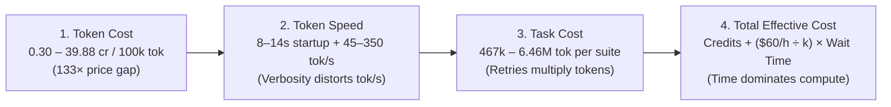

# The Real Cost of GitHub Copilot Models: Why Cheap Tokens Can Cost You More in Waiting Time

When choosing a model in GitHub Copilot, most developers look at two numbers: **token price** (how many AI Credits a model burns) or **token speed** (`tok/s`).

Both can trick you. If a model saves **$0.49** in AI Credits on a hard task but takes **6.7 minutes** instead of **52 seconds**, an engineer whose time is worth **$60/hour ($1/minute)** just paid **$5.88** in waiting time to save 49 cents.

To see the full picture, I ran **392 sequential benchmark tests** across **28 GitHub Copilot-hosted models** (`Anthropic Claude`, `OpenAI GPT-5/GPT-6`, `Google Gemini`, `xAI Grok`, `Microsoft MAI`, and `auto`):

- **280 Single-Turn Speed Runs (`28 models × 10 scenarios`):** 1-word baseline, 500-word essay, logic puzzles (`low` and `high` effort), and coding tasks across `Python`, `JavaScript`, `Go`, `Java`, `C++`, and `Rust`.
- **112 Agentic Task Runs (`28 models × 4 verified tasks`):** Autonomous tool-use runs (`--allow-all-tools`) checked by unit tests and a 1,523-case differential fuzz verifier.

Here is how the four pieces of the puzzle fit together: **Token Cost → Token Speed → Task Cost → Human Waiting Cost**.



---

## 1. Token Cost: A 133× Price Gap Across Hosted Models

GitHub Copilot bills agentic usage in **AI Credits** (`1 AI Credit = $0.01 USD`). Across our 112 agentic runs, input tokens (reading files, tool schemas, and history) made up **95%–98%** of all tokens used. Dividing total credits by total tokens reveals four clear price tiers:

| Tier | Representative Hosted Models | Credits per `100k` Tokens | USD per `1M` Tokens | Multiplier vs. `auto` |
| :--- | :--- | ---: | ---: | ---: |
| **1. Economy** | `auto` (`0.30`), `gpt-6-luna` (`0.31`), `claude-haiku-5.5` (`0.32`), `gpt-5.6-luna` (`0.68`), `mai-code-1.1-flash` (`0.93`) | **0.30 – 0.93** | **$0.03 – $0.09** | **1× – 3×** |
| **2. Flash / Mini** | `gpt-5-mini` (`1.56`), `gemini-3.8-flash` (`1.66`), `gemini-3.7-flash` (`2.09`), `claude-haiku-4.5` (`2.26`), `gpt-5.4-mini` (`2.71`) | **1.56 – 2.71** | **$0.16 – $0.27** | **5× – 9×** |
| **3. Frontier Standard** | `gpt-5.6-terra` (`5.76`), `gpt-6-sol` (`6.07`), `gpt-6.1-sol` (`6.30`), `gpt-5.3-codex` (`8.12`), `claude-sonnet-5.5` (`8.87`), `gemini-4-argon` (`11.17`), `claude-sonnet-5` (`11.47`) | **5.76 – 11.47** | **$0.58 – $1.15** | **19× – 38×** |
| **4. Heavyweight** | `claude-opus-5.5` (`13.90`), `gpt-5.6-sol` (`14.60`), `gpt-5.5` (`17.60`), `claude-opus-5` (`18.01`), `claude-opus-4.8` (`19.81`), `gpt-6-astra` (`35.38`), `claude-fable-5` (`39.88`) | **13.90 – 39.88** | **$1.39 – $3.99** | **46× – 133×** |

If per-token price were everything, you would always pick Tier 1 (`auto` or `claude-haiku-5.5`). Next, let's see why speed and retries change the math.

---

## 2. Token Speed: Why High `tok/s` Doesn't Always Mean Fast Code

In a single-turn call (`copilot -p "..." --model <M> -s`), end-to-end `tok/s` is `Output_Tokens / Total_Wall_Time`. Because every call pays an **8 to 14 second startup and prefill delay** before the first token appears, `tok/s` can be deceptive:

- **`claude-opus-5` ranks #4 in coding `tok/s` (`49.3 tok/s`), yet has the slowest wall-clock time (`32.2s`):** It writes `1,634` tokens per task (over 2× the average), which dilutes the `8s` startup delay and inflates `tok/s` while making you wait half a minute. (`claude-opus-5.5` trims verbosity by 38%, cutting wait time to `20.4s`.)
- **Concise models are faster than their `tok/s` rank suggests:** `gpt-5.6-luna` (`13.4s`) and `gpt-6-luna` (`14.0s`) finish coding faster than 24 of the 28 models, but rank mid-pack on `tok/s` (`34–36 tok/s`) simply because they write compact `~500`-token answers.
- **The true speed leaders (`<14s` wall time AND `>49 tok/s`):** **`claude-haiku-5.5`** (`11.5s`, `63.6 tok/s`), **`gpt-5.6-terra`** (`12.6s`, `49.1 tok/s`), **`claude-sonnet-5.5`** (`13.8s`, `54.7 tok/s`), and **`gpt-5.4-mini`** (`13.8s`, `51.6 tok/s`).


Subtracting the 1-word startup time (`T_short`) from the 500-word essay time (`T_long`) reveals what happens behind the scenes:


1. **`auto` has the slowest cold start (`13.7s`), vs. `7.7–8.1s` for Claude and `9.0–9.5s` for GPT.**
2. **Once streaming starts, flash/mini models burst at `280–350 tok/s`** (`auto` at `~350 tok/s`, `gpt-5.4-mini` at `~305 tok/s`, `mai-code-1.1-flash` at `~284 tok/s`).
3. **`auto` and `claude-haiku-4.5` fail if you pass `--reasoning-effort`.**

Rankings also shift sharply when moving from prose to code:


Across the 6 programming languages (`Python`, `JavaScript`, `Go`, `Java`, `C++`, `Rust`), the full 280-run heatmap highlights the best model for each language:


- **Python:** `gpt-5.6-terra` (`58.3 tok/s`, `13.6s`), `claude-sonnet-5.5` (`56.2 tok/s`, `13.2s`), or `claude-haiku-5.5` (`10.2s`).
- **JavaScript / TypeScript:** `claude-haiku-5.5` (`63.0 tok/s`, `11.3s`), `gpt-5.6-terra` (`11.0s`), or `claude-sonnet-5.5` (`13.2s`).
- **Go:** `claude-haiku-5.5` (`54.5 tok/s`, `11.5s`) or `gpt-5.6-luna` (`43.6 tok/s`, `13.5s`).
- **Java:** `claude-haiku-5.5` (`73.8 tok/s`, `11.1s`), `mai-code-1.1-flash` (`66.7 tok/s`, `13.8s`), or `claude-sonnet-5.5` (`63.7 tok/s`, `13.3s`).
- **C++:** `claude-haiku-5.5` (`55.6 tok/s`, `11.2s`) or `claude-sonnet-5.5` (`53.2 tok/s`, `13.5s`). *(Four GPT-5 models returned ultra-short 30-token snippets on C++, dragging down their 6-language average.)*
- **Rust:** `claude-haiku-5.5` (`91.1 tok/s`, `13.6s`), `gpt-5.6-terra` (`74.6 tok/s`, `14.5s`), or `claude-sonnet-5.5` (`68.1 tok/s`, `16.6s`). *(Rust prompts generated 2.2× more tokens than Go/C++, pushing slower models like `gemini-3.8-flash` to `51.4s`.)*

---

## 3. Task Cost: How Agentic Retry Loops Multiply Token Burn

In real work, an agent doesn't just print one snippet — it edits code, runs tests, reads errors, and retries. We tested all 28 models on **4 verified tasks**:

1. **`bugfix`:** Fix 12 failing unit tests in `inventory.py` (`28/28` passed).
2. **`expr`:** Build an arithmetic expression parser/evaluator without `eval` (`28/28` passed).
3. **`csvstats`:** Aggregate a dirty 20,000-row CSV into `report.json` (`28/28` passed).
4. **`regex` *(Complex)*:** Build a regex engine from a spec alone, tested against Python's `re` across **1,523 fuzz cases** (`9/28` passed all 1,523 strictly; `14/28` passed 1,522/1,523 and missed only an unrequested `(a?)*?` lazy-quantifier trap; `5/28` failed outright).


Look at **Panel B (`4-Task Context Volume`)**:
- **Smart models finish in fewer turns:** **`claude-sonnet-5.5`** solved all 4 tasks (including 1,523/1,523 strict `regex`) in just **`111.7 seconds`**, reading only **`588k` input tokens** total (`$0.53` in AI Credits).
- **Weaker models get stuck in retry loops:** **`claude-haiku-5.5`** finished the 3 simple tasks in `72.8s`, but spent **`404.4 seconds` (`6.7 minutes`)** and **`729k` tokens** debugging `regex`. Worse, **`gemini-3.8-flash`** re-read **`6.46M` tokens** (`1,080s`), and 5 models (`claude-haiku-4.5`, `grok-4.5`, `grok-4.7`, `gpt-5-mini`, `gpt-6-astra`) burned up to 15 minutes and still failed.

---

## 4. Total Effective Cost: Adding Your Waiting Time (`$60/h ÷ k` Tasks)

AI Credits are only the compute bill. If an engineer costs **$60/hour (`$1/minute`)** and runs **`k` tasks in parallel** (multitasking across terminals or background agents), the real cost of a task is:

```text
Total Effective Cost = (AI Credits × $0.01) + (Wall_Seconds / 3600) × ($60 / k)
```

### When You Wait on One Task (`k = 1`, `$60/h`)


When `k = 1` (`$60/h`), **human waiting time is 57% to 99.5% of the total cost**:
- **`claude-sonnet-5.5` is #1 (`$2.39` total):** `$0.53` in credits + `$1.86` in waiting time (`111.7s`). It beats `auto` (`$3.19`) by `$0.80` because finishing 78 seconds faster saves `$1.31` of engineer time.
- **`auto` (`$3.19`), `gpt-6-luna` (`$3.42`), and `gpt-5.6-luna` (`$3.51`)** take #2–#4 (`~$0.02–$0.04` in credits, `~190–208s` wait).
- **`claude-haiku-5.5` drops from #3 in credits (`$0.04`) to #16 in total cost (`$7.99`)** because waiting `477s` costs `$7.95` of human time.

### What If You Multitask (`k = 2, 3, 6...`)?

Dividing `$60/h` by `k` concurrent tasks reveals two clear rules:


1. **The `k = 2.5` Multitasking Crossover (Left Panel):**
   - For **1 or 2 concurrent tasks (`$60/h` or `$30/h`)**, **`claude-sonnet-5.5` is the cheapest overall** (`$2.39` at `k=1`, `$1.46` at `k=2`).
   - Once you run **3 or more tasks in parallel (`≤ $20/h` per task)**, **`auto` (`$1.07` at `k=3`) and `gpt-6-luna` (`$1.15` at `k=3`)** become the cheapest. (Exact break-even: **`$23.53/h`**, or **`k = 2.55` tasks**.)
2. **Simple Tasks vs. Hard Tasks (Right Panel):**
   - On the **3 simple tasks (`bugfix + expr + csvstats`)**, **`claude-haiku-5.5` wins #1 even at `$60/h` (`k=1`)**: `$0.01` credits + `$1.21` time (`72.8s`) = **`$1.23`**, beating `claude-sonnet-5.5` (`$1.35`).
   - On the **hard `regex` task**, **`claude-sonnet-5.5` (`$1.04` in `51.7s`)** is **6.5× cheaper** than `claude-haiku-5.5` (`$6.77` in `404.4s`).

| Rank (`k=1`) | Model | Pass | 4-Task Time | Total Tokens (`In/Out`) | Credits (`k=∞`, `$0/h`) | `k=6` (`$10/h`) | `k=3` (`$20/h`) | `k=2` (`$30/h`) | `k=1` (`$60/h`) |
| ---: | :--- | :---: | ---: | ---: | ---: | ---: | ---: | ---: | ---: |
| **1** | `claude-sonnet-5.5` | 4/4★ | **111.7s** | 588k / 10.7k | $0.53 | $0.84 | $1.15 | **$1.46** | **$2.39** |
| **2** | `auto` | 4/4* | 190.2s | 594k / 12.7k | **$0.02** | **$0.55** | **$1.07** | $1.60 | $3.19 |
| **3** | `gpt-6-luna` | 4/4* | 203.8s | 616k / 15.1k | **$0.02** | $0.59 | $1.15 | $1.72 | $3.42 |
| **4** | `gpt-5.6-luna` | 4/4* | 207.9s | 602k / 12.3k | $0.04 | $0.62 | $1.20 | $1.77 | $3.51 |
| **5** | `gpt-6-sol` | 4/4* | 213.3s | 652k / 12.2k | $0.40 | $1.00 | $1.59 | $2.18 | $3.96 |
| **6** | `gpt-6.1-sol` | 4/4* | 224.2s | **467k** / 10.1k | $0.30 | $0.92 | $1.55 | $2.17 | $4.04 |
| **7** | `gpt-5.6-sol` | 4/4* | 212.9s | 486k / 13.1k | $0.73 | $1.32 | $1.91 | $2.50 | $4.28 |
| **8** | `mai-code-1.1-flash` | 4/4* | 267.5s | 669k / 33.7k | $0.07 | $0.81 | $1.55 | $2.29 | $4.52 |
| **9** | `gemini-4-argon` | 4/4* | 242.2s | 526k / 14.7k | $0.60 | $1.28 | $1.95 | $2.62 | $4.64 |
| **10** | `claude-sonnet-5` | 4/4★ | 277.7s | 647k / 25.7k | $0.77 | $1.54 | $2.31 | $3.09 | $5.40 |
| **11** | `gpt-5.4-mini` | 4/4* | 308.9s | 995k / 31.7k | $0.28 | $1.14 | $1.99 | $2.85 | $5.43 |
| **12** | `gpt-5.3-codex` | 4/4* | 318.7s | 601k / 18.8k | $0.50 | $1.39 | $2.27 | $3.16 | $5.81 |
| **16** | `claude-haiku-5.5` | 4/4★ | 477.2s | 1,171k / 31.6k | $0.04 | $1.36 | $2.69 | $4.02 | $7.99 |
| **17** | `gpt-5.6-terra` | 4/4* | 471.1s | 919k / 16.4k | $0.54 | $1.85 | $3.16 | $4.46 | $8.39 |
| **18** | `claude-opus-5` | 4/4★ | 374.8s | 1,203k / 24.8k | $2.21 | $3.25 | $4.29 | $5.33 | $8.46 |
| **21** | `claude-opus-5.5` | 4/4★ | 601.6s | 902k / 16.7k | $1.28 | $2.95 | $4.62 | $6.29 | $11.30 |
| **23** | `gemini-3.8-flash` | 4/4★ | 1,080.3s | 6,461k / 36.6k | $1.08 | $4.08 | $7.08 | $10.08 | $19.08 |

*(Full 28-model scores, including #13–#28 and the 5 failed runs, are shown in Fig. 5 and Fig. 6 above.)*

---

## 5. Critique: 4 Flaws in Our Own Assumptions

While `Credits + ($60/k) × Time` is much better than looking at token prices alone, we should be honest about where this philosophy breaks down:

1. **Waiting time is not linear:** You cannot productively switch tasks during a **20-second** wait (so `k` is really `1` on short tasks). Conversely, a **7-minute** wait forces you to switch context to Slack or another ticket, which adds a **2–5 minute mental reload penalty** when you come back.
2. **Human review doesn't scale as `$60 / k`:** Running 6 agents in parallel does not cut human effort by 6×. A human still has to write 6 prompts, review 6 PR diffs, and resolve merge conflicts. Practical interactive multitasking tops out around **`k = 2 to 3`**.
3. **Failed runs and messy diffs have hidden rework costs:** Five models failed `regex` after burning 11–15 minutes (`claude-haiku-4.5`, `grok-4.5`, `grok-4.7`), costing `$11–$15` of time while delivering zero working code. Furthermore, `claude-sonnet-5.5` passed all `1,523/1,523` strict tests with `6.0k` tokens of clean code, whereas `auto` and `gpt-6-luna` needed the `(a?)*?` spec exemption and `grok-4.6` dumped `41.7k` tokens of code that would be painful to review.
4. **Single-run noise (`N = 1`) and `auto` opacity:** Each cell was tested once, so a single unlucky bug loop (`claude-haiku-5.5`'s `404s` on `regex`) heavily skews totals. Also, `auto` is a dynamic router whose backend model and pricing can change without notice.

---

## 6. Bottom Line: Which Model Should You Use?

| Your Scenario | Best Model Choice | Why |
| :--- | :--- | :--- |
| **Daily interactive coding & hard bugs (`k = 1–2`)** | **`claude-sonnet-5.5`** | Lowest total cost (`$2.39` at `$60/h`), fastest 4-task completion (`111.7s`), and `1,523/1,523` strict pass. |
| **Quick scripts, simple bugfixes & fast single-turn edits** | **`claude-haiku-5.5`** or **`gpt-5.6-luna`** | #1 on the 3 routine tasks (`$1.23` in `72.8s`) and #1 in single-turn coding speed (`63.6 tok/s`). |
| **Running 3+ background agents in parallel (`k ≥ 3`)** | **`gpt-6-luna`**, **`gpt-5.6-luna`**, or **`auto`** | Once waiting time is split across 3+ tasks (`≤ $20/h`), their `$0.02–$0.04` credit cost wins (`$1.07–$1.20` total). |
| **Heavy architectural reasoning** | **`claude-sonnet-5.5`** or **`claude-opus-5.5`** | Skip `claude-opus-5` (too verbose and slow); `claude-sonnet-5.5` and `claude-opus-5.5` are much faster and cheaper. |

